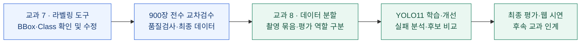

<div align="center">

# 조각김치 이물검출

**라벨 품질 관리부터 객체검출 모델의 학습·평가까지**

AI Campus · Group 3 · 교과 7 & 8

`Python` · `Tkinter` · `PyTorch` · `Ultralytics YOLO11` · `FastAPI`

[라벨링 도구](subject7/README.md) · [객체검출 모델](subject8/README.md) · [발표자료](presentation/README.md) · [문서 작성 규칙](CONTRIBUTING.md)

</div>

---

## 프로젝트 소개

작은 이물을 검출하려면 모델 개선과 함께 **정답 라벨의 품질과 평가 데이터의 구성**을 살펴야 합니다. 이 프로젝트는 교육용 조각김치 이미지 900장의 라벨을 직접 검수하는 도구를 만들고, 촬영 묶음을 고려해 데이터를 나눈 뒤 YOLO11 모델을 학습·평가한 팀 프로젝트입니다.

라벨이 바뀐 이유와 실험의 성공·실패를 기록하고, 최종 모델이 놓치는 대상까지 확인했습니다. 데이터는 산업데이터와 유사하게 가상 생성된 교육용 데이터이며, 실제 생산라인에 배포한 시스템은 아닙니다.



## 핵심 결과

| 데이터 검수 | 같은 Validation에서의 모델 개선 | 최종 Frozen Test |
|:---:|:---:|:---:|
| **900장 전수 교차검수** | **mAP50–95 0.470 → 0.749** | **mAP50–95 0.639** |
| 최종 BBox 4,561개 · 라벨 변경 235장 | `kimchi_v5` · Val 104장 · YOLO11n → YOLO11s | 82장 · 432 BBox · Final `exp050` |


Val은 모델 선택에, Test는 선택된 모델의 최종 평가에 사용했습니다. Final의 Val 0.749는 동일 조건 seed 5개 중 최고 값이며 평균은 0.739입니다. Final 확정 전 Test 점수를 한 차례 열람한 기록도 공개합니다. 데이터와 평가의 한계는 아래 근거 문서에서 확인할 수 있습니다.

근거: [라벨 QA](subject7/reports/qa_summary.md) · [학습 결과 CSV](subject8/reports/runs_summary.csv) · [모델 선택 근거](subject8/reports/final_model_selection.md) · [최종 Test CSV](subject8/reports/05_final/final_metrics.csv) · [평가 이력](subject8/reports/04_improvement/baseline_vs_improved.md)

## 무엇을 만들었나

| 구성 | 구현 내용 | 상세 안내 |
|---|---|---|
| **라벨링 도구** | BBox·Class 편집, RAW 비교, 검수 기록, 무결성 검사, 최종 데이터 생성 | [교과 7 README](subject7/README.md) |
| **객체검출 모듈** | 데이터 점검·분할, Baseline, 해상도·모델·증강 실험, 실패 분석·최종 평가 | [교과 8 README](subject8/README.md) |
| **웹 시연** | 사진별 예측·정답 비교, 확신도 조절, Val 일괄 채점, 보고서·후보 TXT 저장 | [웹 시연 설명서](subject8/docs/app/server.md) |
| **통합 발표자료** | HTML 슬라이드, 발표 대본·진행표, 녹화 시연·라이브 GUI 연결 | [발표 README](presentation/README.md) |

### 라벨링 도구 미리보기


*직접 만든 설명용 가상 샘플 화면입니다. 학습용 원본 사진을 공개한 화면이 아닙니다.*

## 설계에서 중요하게 본 것

- **원본 보호와 변경 추적**: RAW를 직접 수정하지 않고 작업본에 저장하며, 추가·수정·삭제된 BBox와 검수 기록을 남깁니다.
- **평가 역할 분리**: 촬영 묶음을 고려해 Train·Val·Test·후속 교과용 Bridge를 구분했습니다. 분할의 예외와 잔여 누수 가능성도 [정책 문서](subject8/docs/project/split_policy.md)에 기록했습니다.
- **근거가 있는 모델 선택**: 같은 데이터 버전에서 후보와 seed 결과를 비교하고, 채택하지 않은 실험도 [실험 기록](subject8/reports/04_improvement/experiment_log.csv)에 남겼습니다.
- **한계가 드러나는 결과 보고**: 평균 점수와 함께 Class별 결과·작은 객체의 실패를 확인했습니다. **Frozen Test의 갈변 Recall은 0**이며, 정상 김치 사진이 없어 정상 제품의 오검출률은 검증하지 못했습니다.

## 실행·문서 안내

| 하고 싶은 일 | 시작할 곳 |
|---|---|
| 라벨링 도구 설치·실행 | [교과 7 빠른 시작](subject7/README.md#빠른-시작) |
| 모델 예측·웹 시연 | [교과 8 빠른 시작](subject8/README.md#빠른-시작) |
| 학습 환경·실험 재현 | [교과 8 상세 가이드](subject8/docs/project/guides/training.md) |
| 코드 구조 이해 | [교과 7 문서 목차](subject7/docs/README.md) · [교과 8 문서 목차](subject8/docs/README.md) |
| 결과·모델의 근거 확인 | [보고서 목차](subject8/reports/README.md) · [모델 목록](subject8/models/README.md) |
| 발표자료 보기 | [발표 준비·실행](presentation/README.md) — 사진·영상은 별도 준비 |

```text
group_3/
├── README.md                 프로젝트 소개·핵심 결과
├── CONTRIBUTING.md           문서 작성·경로·공유 규칙
├── subject7/                 라벨링 도구·검수·최종 데이터
│   ├── src/ · tools/ · tests/
│   ├── docs/                 코드 설명서 + project/ 상세 문서
│   └── reports/              품질검사·테스트 근거
├── subject8/                 객체검출·학습·평가·웹 시연
│   ├── src/ · scripts/ · app/
│   ├── docs/                 코드 설명서 + project/ 상세 문서
│   └── reports/ · models/ · runs/
└── presentation/             발표 화면·대본·진행표
```

## 데이터와 공개 범위

원본 사진·RAW·WORK·작업 중 검수표·실제 사진이 포함된 캡처와 영상은 Git에서 제외합니다. 허용된 최종 라벨·검수표·모델·학습 기록·그래프만 각 폴더의 `.gitignore`에 따라 공유합니다. 원본 데이터는 별도로 준비해야 합니다.

코드 설명서는 `subject7/src/…py → subject7/docs/src/…md`처럼 **각 교과의 루트 경로를 미러링**합니다. 사용법·정책·설계·회의록·인계 문서는 `docs/project/`, 실험·검증 결과는 `reports/`에 둡니다. [작성 규칙 보기](CONTRIBUTING.md)
