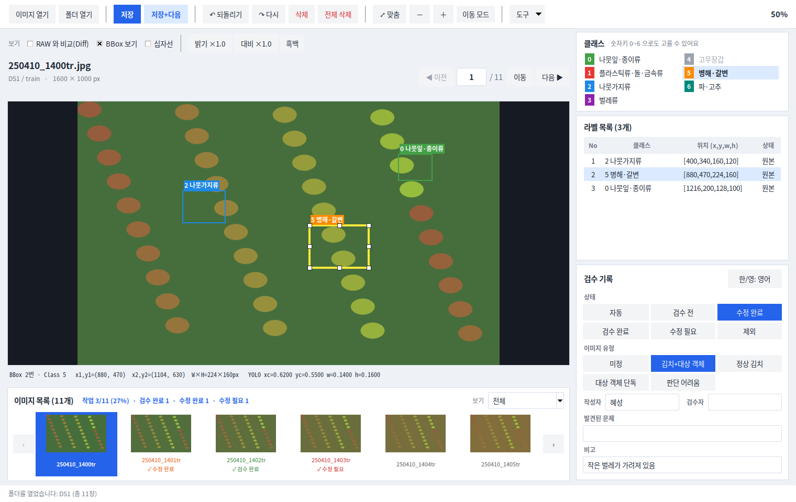

<div align="center">

# 조각김치 이물검출

**검수한 정답 데이터에서, 이물을 찾는 모델까지**

AI Campus · Group 3

</div>

**교과 7에서 정답 라벨을 검수하고, 교과 8에서 그 정답으로 객체검출 모델을 학습·평가**한 팀 프로젝트입니다. 교육용으로 가상 생성된 조각김치 이미지 900장을 사용했습니다.

**교과 7·8 종료 (2026-10-21) · 발표 완료 (2026-10-22)** — [종료 현황](PROJECT_STATUS.md) · [발표자료](subject8/presentation/README.md)

## 저장소 구성

| 폴더 | 교과 | 내용 | 상태 |
|---|---|---|---|
| [`subject7/`](subject7/README.md) | 교과 7 | 라벨링 도구 · 900장 전수 교차검수 · 최종 라벨 | 종료 |
| [`subject8/`](subject8/README.md) | 교과 8 | 객체검출 학습·평가 · 웹 시연 · 교과 7·8 통합 [발표자료](subject8/presentation/README.md) | 종료 · 발표 완료 |

교과 7·8은 하나로 이어진 프로젝트입니다. 교과 8이 교과 7의 최종 라벨을 직접 읽고, `subject8/scripts/00_setup.py` 한 번으로 두 교과의 가상환경(`subject7/.venv` · `subject8/.venv`)과 데이터를 준비합니다. 이후 교과는 `subjectN/` 폴더로 추가하며 교과 7·8과 독립적으로 자기 의존성·가상환경을 둡니다 — [교과별 가상환경과 의존성](CONTRIBUTING.md#교과별-가상환경과-의존성)

## 핵심 결과

### 교과 7 · 학습에 쓸 정답 만들기

사진 속 이물의 **위치(BBox)와 종류(Class)를 사람이 확인·수정하는 도구**를 만들었습니다. 검수 이력을 남기고 품질검사를 통과한 최종 데이터를 교과 8로 넘겼습니다.

> **900장 전수 교차검수 · 235장 라벨 변경**



*교과 7의 라벨 편집·검수 기록 화면입니다. 공개용으로 직접 만든 가상 샘플을 사용했습니다.*

[도구 설치·사용법](subject7/README.md) · [검수 결과](subject7/reports/qa_summary.md)

### 교과 8 · 정답으로 검출 모델 만들기

교과 7의 검수 데이터를 학습·검증·평가용으로 나누고, 작은 이물을 놓치는 원인을 분석하며 **YOLO11n → YOLO11s**로 모델을 개선했습니다.

> **Validation 0.470 → 0.749 · 최종 Test 0.639**


*객체검출 성능지표 mAP50–95 기준입니다. 왼쪽은 같은 검증 이미지 104장에서의 개선 비교, 오른쪽은 최종 모델을 별도 평가 이미지 82장에서 확인한 결과입니다.*

[모델 예측·웹 시연](subject8/README.md) · [모델 선택 근거](subject8/reports/final_model_selection.md)

종료 시점 모델의 알려진 한계는 갈변 검출과 정상 김치에서의 오검출 평가입니다.

<details>
<summary>평가 조건·한계와 근거</summary>

- 공식 데이터 버전은 `kimchi_v5`, 최종 모델은 YOLO11s `exp050`입니다.
- Validation은 104장, Frozen Test는 82장입니다. 서로 다른 평가 역할이므로 두 점수를 직접적인 성능 개선으로 비교하지 않습니다.
- Final의 Val 0.749는 동일 조건 seed 5개 중 최고 값이며 평균은 0.739입니다. Baseline 0.470과 Final 0.749는 학습 중 best epoch 기준입니다.
- Final 확정 전에 Test 점수를 한 차례 열람한 기록이 있습니다. 평가 이력은 아래 보고서에 남겼습니다.
- 갈변의 Test Recall은 0입니다. 정상 김치 사진이 없어 정상 제품의 오검출률은 검증하지 못했습니다. 새 생산현장에 배포한 시스템은 아닙니다.
- v4 → v5 변경은 동일 사진의 중복이 아니라 **같은 촬영 묶음의 Train·Val 공유**를 줄인 것입니다. v4는 Val 132장 중 83장, v5는 Val 104장 중 6장(G00 예외)이 Train과 같은 묶음에 속합니다.

[라벨 QA](subject7/reports/qa_summary.md) · [모델 선택 근거](subject8/reports/final_model_selection.md) · [최종 Test 결과](subject8/reports/05_final/final_metrics.csv) · [평가 이력](subject8/reports/04_improvement/baseline_vs_improved.md)

</details>

## 발표·문서

[교과 7·8 통합 발표자료](subject8/presentation/README.md) · [교과 7 코드 문서](subject7/docs/README.md) · [교과 8 코드 문서](subject8/docs/README.md) · [실험·평가 보고서](subject8/reports/README.md)

<details>
<summary>폴더 구조·문서 규칙·공개 범위</summary>

```text
group_3/
├── subject7/            교과 7 — 라벨링 도구·검수·QA        (.venv · requirements.txt)
└── subject8/            교과 8 — 모델 학습·평가·웹 시연     (.venv · requirements.txt)
    └── presentation/    교과 7·8 통합 발표자료·대본·진행표 (2026-10-22 발표본)
```

코드 설명서는 각 교과 폴더를 기준으로 `src/x.py → docs/src/x.md`처럼 같은 경로에 둡니다. 상세 사용법·정책·설계·팀 기록은 `docs/project/`, 검증 결과는 `reports/`에 모읍니다.

원본 사진·RAW·WORK·작업 중 검수표·실제 사진이 포함된 캡처와 영상은 Git에서 제외합니다. 허용된 최종 라벨·검수표·모델·기록·그래프는 각 폴더의 `.gitignore`에 따라 공유합니다. 실행에 필요한 원본 사진은 별도로 준비해야 합니다.

기술: Python · Tkinter · PyTorch · Ultralytics YOLO11 · FastAPI

[문서 작성·공유 규칙](CONTRIBUTING.md)

</details>
