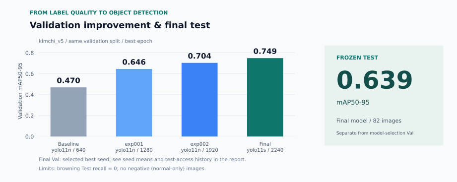

# 교과 8 · 객체검출

**2026-10-21 교과 7·8 종료. 현재는 발표자료를 보완합니다.** [종료 현황](../PROJECT_STATUS.md)

**라벨 품질을 바탕으로 모델을 개선하고, 놓치는 이물까지 확인합니다.**

[전체 프로젝트](../README.md) · [실행·실험 가이드](docs/project/guides/training.md) · [코드 설명서](docs/README.md)

## 최종 결과

| 최종 모델 | mAP50–95 | Test |
|:---:|:---:|:---:|
| **YOLO11s** | **0.639** | **82장** |

공식 데이터는 `kimchi_v5`, 최종 실행은 `exp050`입니다. 갈변의 Test Recall은 0이며, 정상 김치에서의 오검출률은 아직 검증하지 못했습니다.

[모델 선택 근거](reports/final_model_selection.md) · [최종 Test 결과](reports/05_final/final_metrics.csv) · [상세 한계](docs/project/handoff/subject14_handoff.md)

## 빠른 시작

Linux / WSL의 **저장소 루트** (`group_3/`)에서 실행합니다. 원본 사진은 `subject7/data/raw/`에 별도로 준비합니다.

```bash
cd subject8
python3 scripts/00_setup.py
.venv/bin/python scripts/01_check_environment.py
.venv/bin/python scripts/08_predict_images.py --model final --limit 5
```

모델은 `models/`에 있어 환경 준비 후 재학습 없이 예측할 수 있습니다. `--model final`은 공식 모델과 imgsz 2240을 자동으로 선택합니다.

### 웹 시연

준비가 끝난 `subject8/`에서 실행하고 [127.0.0.1:8010](http://127.0.0.1:8010)을 엽니다.

```bash
.venv/bin/python app/server.py
```

정답·예측 비교, 확신도 조절, Validation 일괄 채점, HTML 보고서와 후보 TXT 저장을 지원합니다. 후보 라벨은 사람이 확인·수정·승인한 뒤에 정답으로 사용합니다.

[시연 절차](docs/project/demo_procedure.md) · [서버 설명서](docs/app/server.md)

## 문서 안내

| 필요한 내용 | 문서 |
|---|---|
| 환경 준비·학습·재현 | [실행·실험 가이드](docs/project/guides/training.md) |
| 분할 정책·실험 운영·시연 | [프로젝트 문서](docs/project/README.md) |
| 실험·성능·검증 근거 | [보고서](reports/README.md) · [모델 목록](models/README.md) |
| 종료 범위·미제공·검증 기록 | [프로젝트 종료 현황](../PROJECT_STATUS.md) |

<details>
<summary>개선 과정·평가 조건·구현 상태</summary>



| 평가 | 모델·입력 크기 | mAP50–95 |
|---|---|---:|
| Baseline Validation | YOLO11n · 640 | 0.470 |
| Final Validation | YOLO11s · 2240 | 0.749 |
| Final Frozen Test | YOLO11s · 2240 | 0.639 |

- Val은 v5의 같은 104장, 학습 중 best epoch 기준입니다. 재평가 CSV의 Baseline 0.471과는 측정 시점이 다릅니다.
- Final의 Val 0.749는 동일 조건 seed 5개 중 최고 값이며 평균은 0.739입니다. Val과 Test는 서로 다른 역할의 데이터입니다.
- Final 확정 전 Test 점수를 한 번 열람한 [기록](reports/04_improvement/baseline_vs_improved.md)이 있습니다.
- 갈변 검출, 정상 김치 부재, 촬영 소품 공유·작은 표본 수에 따른 한계는 인계 문서에 남겼습니다.
- 데이터 점검·학습·평가·웹 시연·보고서·후보 TXT 저장은 구현되어 있습니다. 전용 Auto Label 배치 도구(`12_auto_label.py`)는 종료 시점 미제공 기능입니다. 후보 TXT의 사람 수정·승인 전체 흐름은 별도 시험 기록이 확인되지 않았습니다.
- 다른 팀원의 독립 재현 등 별도 확인 기록이 없는 항목은 [인수 시험](reports/05_acceptance/acceptance_test.md)에 구분했습니다.

[모든 학습 실행 CSV](reports/runs_summary.csv) · [Class별 Test 결과](reports/05_final/final_class_metrics.csv) · [보고서 설명서](docs/app/report.md)

</details>

<details>
<summary>데이터 구성·폴더 구조</summary>

| Train | Validation | Frozen Test | Bridge Holdout |
|---:|---:|---:|---:|
| 558장 | 104장 | 82장 | 156장 |

Bridge 156장은 교과 8 학습·선택·평가에 사용하지 않고 보존했습니다. 후속 과제에서 김치 모델·데이터를 사용할지는 미정입니다. 같은 촬영 묶음의 공유를 줄이기 위한 [분할 정책](docs/project/split_policy.md)과 [v5 기준](docs/project/kimchi_v5_split.md)을 따릅니다.

```text
subject8/
├── app/                    웹 시연·보고서
├── src/ · scripts/        공통 모듈·단계별 실행
├── configs/ · manifests/  설정·데이터 분할 기록
├── docs/                   미러 설명서 + project/ 상세 문서
└── reports/ · models/ · runs/   보고서·모델·학습 기록
```

학습·평가 명령은 상세 가이드를 따릅니다. Frozen Test를 점검용으로 반복 실행하거나 Bridge 평가를 교과 8에서 실행하지 않습니다.

</details>
