# 데이터 감사와 분할 — 900장을 "공정한 시험"이 되도록 나누기

> 교과 8 Dataset Audit & Split 과정 정리 (가이드 2~3일차 · 산출물 1)
> 결과 기준서는 [split_policy.md](../split_policy.md), 실행 방법은 [README](../../README.md) 에 있습니다. 이 문서는 **왜 그렇게 했는지 과정을 이해하고 설명하기 위한 문서**입니다.

| 핵심 숫자 | 값 |
|---|---|
| 입력 | 교과 7 FINAL 4K JPG 900장 + YOLO TXT 900개, BBox 4561개 |
| 데이터 오류 | **0건** (12종 검사) |
| 촬영 묶음 | **18개** (촬영 간격 5분 기준) |
| 묶음 사이 거의 같은 사진 | **0쌍** (약 40만 쌍 비교) |
| 최종 분할 `kimchi_v1` | Train 574 / Validation 84 / Frozen Test 84 / Bridge Holdout 158 |
| 재현성 | 스크립트를 다시 돌려도 manifest 가 한 글자도 바뀌지 않음 |

---

## 1. 왜 이 단계가 필요한가

모델 성능은 **시험지(Validation·Test)** 로 잽니다. 그런데 시험지에 **문제집(Train)과 거의 같은 문제**가 섞여 있으면, 모델은 이해하지 못하고 외워도 점수가 높게 나옵니다. 이것이 **Data Leakage(데이터 누수)** 입니다.

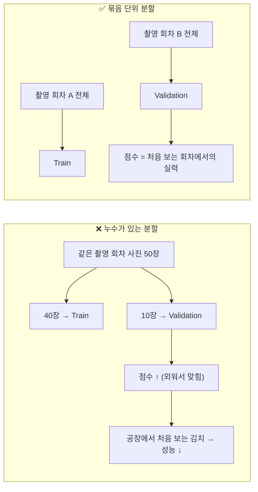

그래서 학습 전에 두 가지를 먼저 합니다.

1. **Data Audit** — 데이터가 학습 가능한 상태인가? (건강검진)
2. **Split** — 공정한 시험이 되도록 어떻게 나눌 것인가? (시험지 만들기)

---

## 2. 전체 흐름

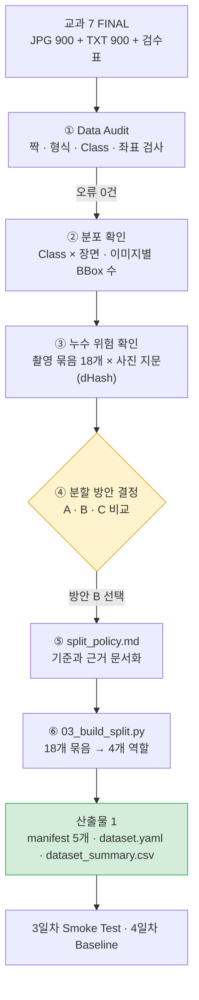

| 단계 | 코드 | 결과 파일 |
|---|---|---|
| ①②③ | `scripts/02_audit_subject7_final.py` (`src/dataset_audit.py`, `src/leakage_check.py`) | `reports/01_data/audit_summary.csv`, `audit_issue.csv`, `audit_class_scene.csv`, `leakage_check.csv`, `capture_group_summary.csv` |
| ④⑤ | 사람이 판단 | `docs/split_policy.md` |
| ⑥ | `scripts/03_build_split.py` (`src/split_builder.py`) | `manifests/*.csv`, `configs/dataset.yaml`, `reports/01_data/dataset_summary.csv` |

---

## 3. ① Data Audit — 데이터 건강검진

YOLO 라벨 한 줄은 `class x_center y_center width height` 이고, 좌표는 사진 크기로 나눈 **비율(0~1)** 입니다.

```text
2 0.7565 0.1622 0.0473 0.0615   →  Class 2(나뭇가지), 중심 (75.6%, 16.2%), 크기 4.7% × 6.2%
```

한 줄을 이렇게 검사합니다.

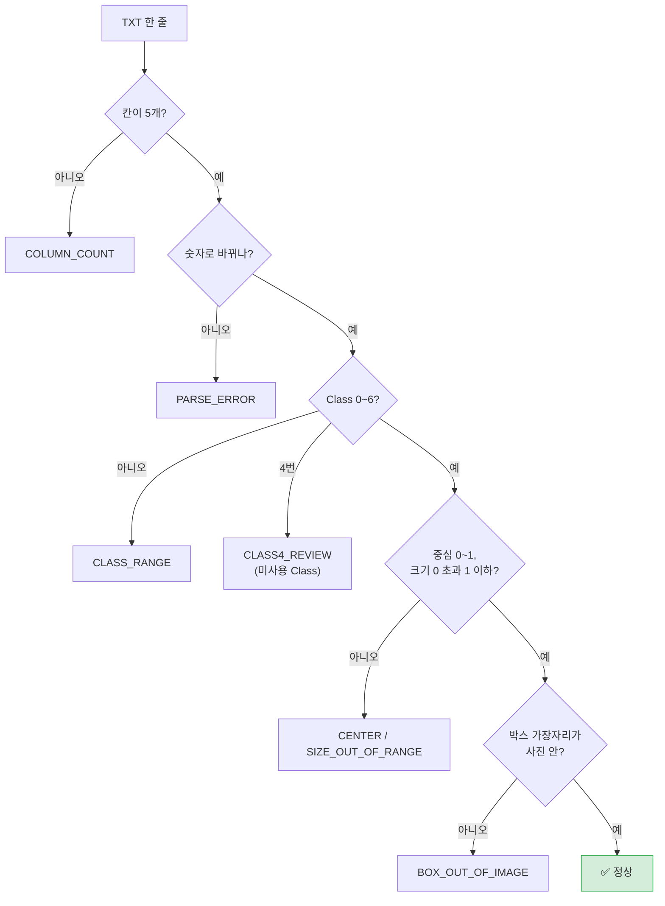

파일 단위로는 짝 없음(`MISSING_IMAGE/LABEL`), 이름 중복(`DUPLICATE_STEM`), 검수표에 없는 사진(`NOT_IN_MANIFEST`), **정상 김치로 기록되지 않은 빈 TXT**(`EMPTY_NOT_NORMAL`)도 검사합니다.

| 결과 | 값 |
|---|---|
| JPG / TXT / 짝 | 900 / 900 / 900 |
| 빈 TXT | 0 (교과 7 Handoff "빈 TXT 0개"와 일치) |
| 이슈 | **0건** |
| Class 4 | 0개 (번호는 유지) |

---

## 4. ② 분포 확인 — 무엇을, 어떤 장면에서 배우는가

### Class별 BBox 수

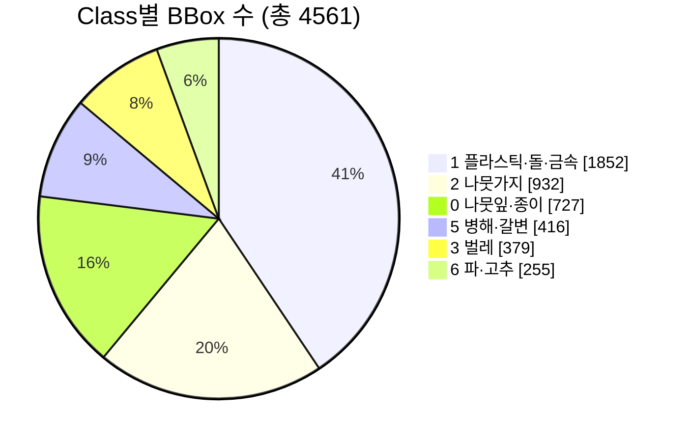

### 장면 유형

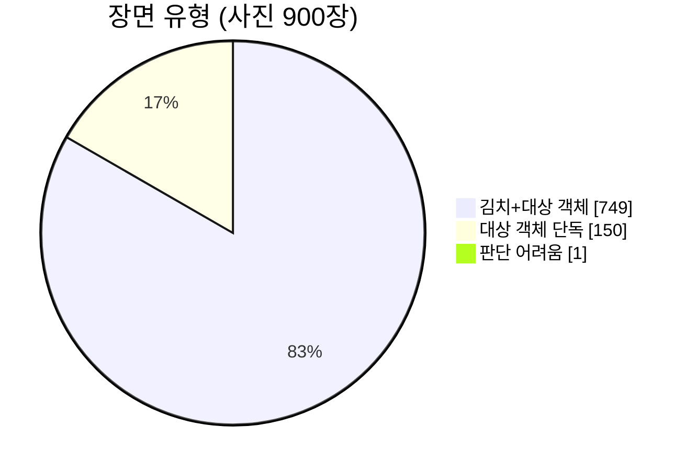

### Class × 장면 — 두 정보를 같이 봐야 보이는 것

| Class | 김치+대상 객체 | 대상 객체 단독 |
|---|---:|---:|
| 0 나뭇잎·종이 | 241 | 44 |
| 1 플라스틱·돌·금속 | 492 | 103 |
| 2 나뭇가지 | 297 | 75 |
| 3 벌레 | 150 | 46 |
| 5 병해·갈변 | 197 | **0** |
| 6 파·고추 | 54 | **0** |

(각 Class 가 들어 있는 **사진 수**)

**발견 3가지**

1. **Class 5·6 은 이물 단독 사진에 없다.** 갈변은 배추에서, 파·고추는 양념과 함께만 나타납니다. → 이물 단독 150장을 시험지로 쓰면 Class 5·6 을 평가할 수 없습니다.
2. **Class 6 은 54장뿐이다.** 그중 50장이 한 촬영 묶음(G00)에 있습니다 (5장에서 다시 다룸).
3. **정상 김치(이물 없음) 사진이 0장이다.** 모델이 "깨끗한 김치"를 따로 배우지 못합니다. → 6일차 FP(오검출) 분석의 힌트.

그 밖에 사진 1장당 BBox 는 평균 5.07개이고 **60%(537장)가 정확히 5개**입니다. 실제 공장 사진(대부분 0~1개)과 다른 점으로 기록해 둡니다.

---

## 5. ③ 누수 위험 확인 — 탐정처럼 따라가 보기

### 5.1 첫 번째 의심: "회사가 나눠 준 validation 을 그대로 쓰면 되지 않나?"

교과 7 FINAL 은 회사가 나눈 `train 720 / validation 180` 을 보존하고 있습니다. 가이드도 이걸 먼저 검토하라고 합니다.

### 5.2 단서: 파일명에 촬영 시간이 있다

```text
250410_144403911987.jpg  →  2025-04-10  14:44:03
```

날짜별로 시간순 정렬하면, 사진 사이 간격은 보통 **10~50초**인데 가끔 **수십 분~1시간 이상** 끊깁니다. 끊긴 곳이 "촬영 회차가 바뀐 곳"이라고 가정하고 **5분 넘게 끊긴 곳에서 묶음을 나눴습니다** → `capture_group` 18개.

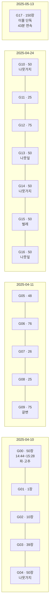

> 묶음마다 **주로 찍은 이물 종류가 다릅니다** (G00 = 파·고추, G15 = 벌레 …). "이물 하나를 정해 놓고 한 회차씩 찍은" 데이터로 보입니다.

### 5.3 검증: 시간으로 나눈 묶음이 진짜 "비슷한 사진 묶음"인가?

가이드는 "시간 문자열을 확인 없이 Session 이라고 단정하지 말라"고 합니다. 그래서 **사진 내용**으로 교차 확인했습니다.

**dHash(사진 지문)** — 사진을 17×16 흑백으로 줄이고, 옆 픽셀보다 밝으면 1 → 256개의 0/1. 두 지문의 다른 칸 수(0~256)가 작을수록 비슷한 사진입니다.

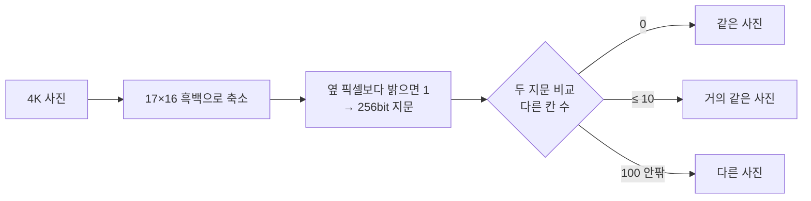

| 결과 | 값 | 해석 |
|---|---:|---|
| 완전히 같은 사진 쌍 | 0 | 중복 파일 없음 |
| 거의 같은 사진 쌍 | 88 | **전부 같은 묶음 안** (G17) |
| 다른 묶음 사이의 거의 같은 쌍 | **0** | 묶음 단위로 나누면 사진 수준 누수 없음 ✅ |
| 평균 거리: 같은 묶음 / 다른 묶음 | 74.8 / 111.8 | 같은 묶음 사진이 더 비슷 → 시간 묶음 = 촬영 묶음 ✅ |

### 5.4 결정적 증거: 회사 validation 은 같은 회차 안에서 나뉘어 있었다

| 묶음 | 원래 train | 원래 validation |
|---|---:|---:|
| G12 (04-24 13:12~14:01) | 59 | 16 |
| G17 (05-13 43분 연속) | 120 | 30 |
| … 18개 중 **17개** 묶음이 이렇게 섞임 | 720 | 180 |

→ 회사 validation 을 그대로 쓰면 **같은 회차 사진이 Train 과 Validation 양쪽에** 들어갑니다. 그래서 **쓰지 않고, 묶음 단위로 새로 나눴습니다.** (원래 구분 정보는 manifest 에 보존)

---

## 6. ④ 분할 방안 결정 — 세 가지를 비교하고 하나를 고르기

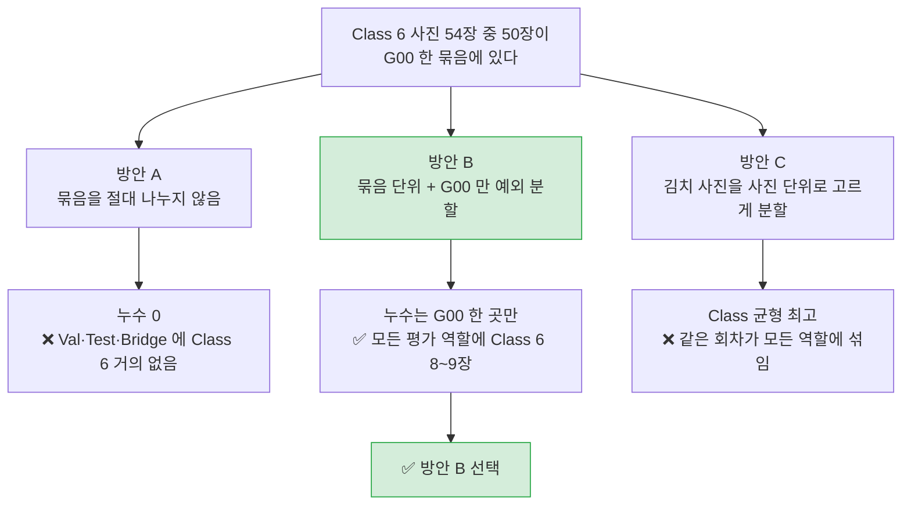

| 방안 | 장점 | 단점 |
|---|---|---|
| A. 완전 묶음 단위 | 누수 0, 설명 쉬움 | Class 6 을 교과 8·14 어디서도 평가 불가 |
| **B. 묶음 단위 + G00 예외** | 원칙 유지, 예외 1건, 희귀 Class 평가 가능 | 예외 근거를 문서화해야 함 |
| C. 사진 단위 분할 | 수량·Class 비율을 정확히 맞춤 | "처음 보는 회차" 성능을 못 잼 → 점수 과대평가 위험 |

**B 를 고른 이유**

- C 가 재는 것은 "아는 회차의 다른 사진"이고, 교과 14 공장에서 만날 것은 "처음 보는 회차"입니다.
- G00 예외는 근거가 있습니다: 50장의 배치·모양이 모두 다름 (육안 확인), 묶음 안 지문 거리 중앙값 104 ≈ 다른 묶음 사이 112.
- 가이드 문구가 "**가능한 한** 한 역할에만 배정"이라 근거를 남긴 예외는 허용 범위입니다.
- G00 은 **시간순 연속 블록**으로 자릅니다 (바로 앞뒤 사진이 가장 비슷하므로 경계를 최소로).

---

## 7. ⑥ 최종 분할 `kimchi_v1`

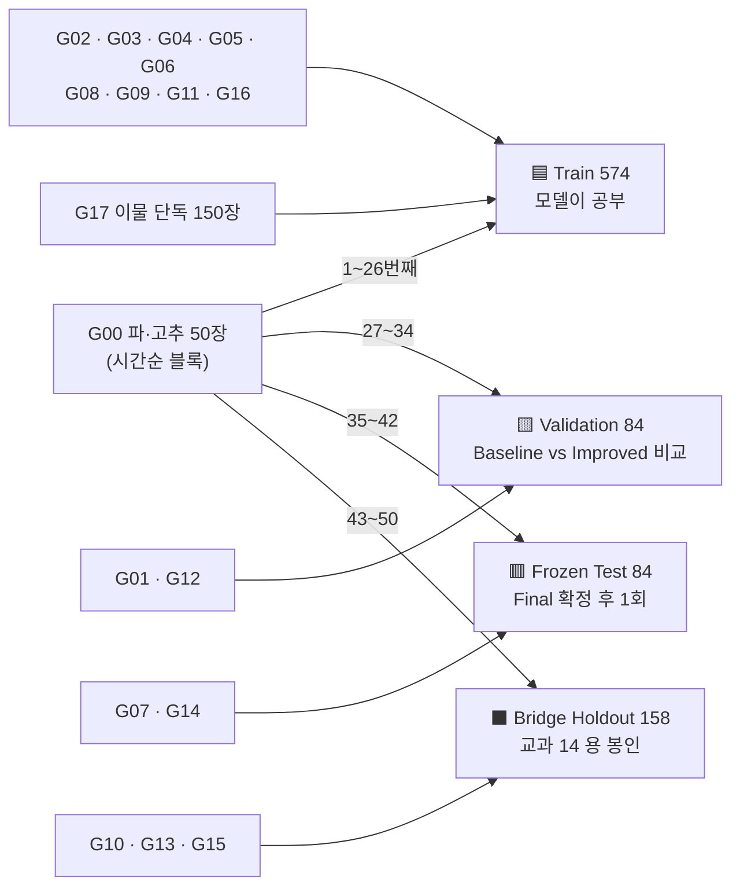

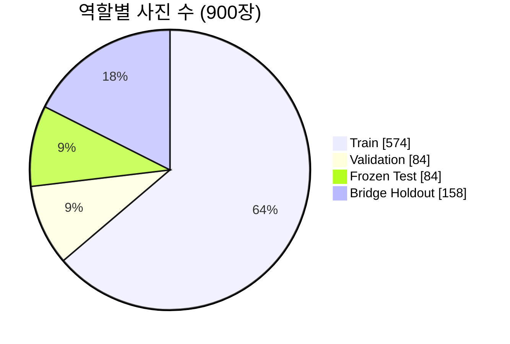

| 역할 | 장수 | C0 | C1 | C2 | C3 | C5 | C6 | 언제 쓰나 |
|---|---:|---:|---:|---:|---:|---:|---:|---|
| Train | 574 | 143 | 421 | 206 | 97 | 86 | 29 | 4·7일차 학습 |
| Validation | 84 | 61 | 52 | 24 | 19 | 44 | 8 | 5~7일차 비교, Final 선택 |
| Frozen Test | 84 | 16 | 51 | 67 | 21 | 25 | 8 | 8일차 Final 확정 후 **한 번만** |
| Bridge Holdout | 158 | 65 | 72 | 75 | 60 | 43 | 9 | 교과 14 (교과 8 에서는 안 씀) |

- Validation·Test·Bridge 는 **모두 김치+이물 장면**입니다 (교과 14 실제 검사 장면과 같음).
- 모든 평가 역할에 Class 0~3·5·6 이 **8장 이상** 들어 있습니다.
- Bridge Holdout 은 `dataset.yaml` 에 넣지 않습니다.

### 각 역할의 사용 시점

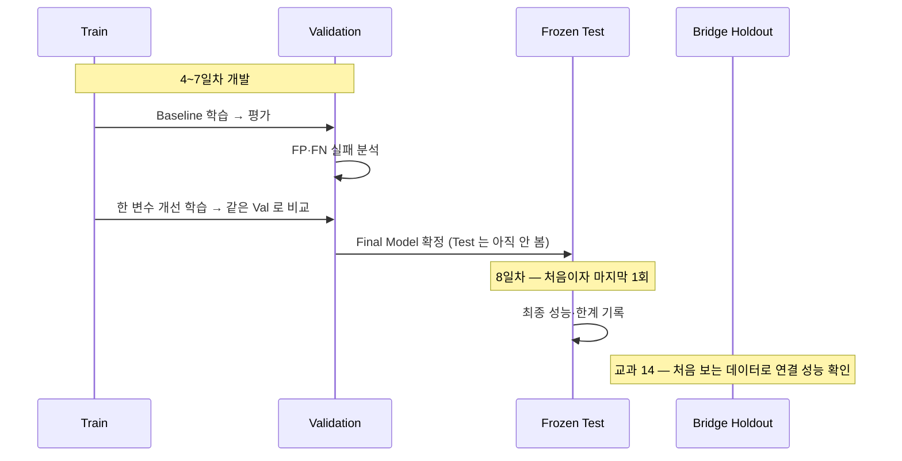

---

## 8. 재현 방법

```bash
cd subject8
python scripts/02_audit_subject7_final.py   # ①②③ 감사 + 분포 + 누수 (약 3초)
python scripts/03_build_split.py            # ⑥ manifest · dataset.yaml · dataset_summary
git status                                   # manifests/ 가 바뀌지 않았으면 재현 성공
```

---

## 9. 알려진 한계

| 한계 | 영향 | 대응 |
|---|---|---|
| 정상 김치(이물 없음) 0장 | 깨끗한 김치에서 FP 가 생길 수 있음 | 6일차 실패분석에서 확인 |
| Class 6 평가 장수 8~9장, 같은 회차 출신 | Class 6 성능이 다소 좋게 나올 수 있음 | 보고서에 함께 기록 |
| 역할마다 Class 비율이 다름 | Val 점수와 Test 점수를 직접 비교하기 어려움 | Class 별 지표를 함께 봄 |
| dHash 는 반전·회전·같은 이물 재촬영을 못 잡음 | 일부 누수를 놓칠 수 있음 | 변형 사진은 넣지 않았음 |
| 사진당 BBox 가 대부분 5개 (가상 데이터) | 공장 실제 분포와 다름 | 교과 14 에서 실제 데이터로 확인 |

---

## 10. 발표·면접 Q&A

**Q. 왜 회사가 준 validation 을 쓰지 않았나요?**
A. 18개 촬영 회차 중 17개에서 같은 회차 사진이 train 과 validation 에 나뉘어 있었습니다. 그대로 쓰면 같은 조명·같은 김치 사진이 시험에 나와 점수가 부풀려집니다. 회차(촬영 묶음) 단위로 새로 나눴고, 원래 구분은 manifest 에 보존했습니다.

**Q. 촬영 묶음을 시간 5분으로 나눈 근거는?**
A. 사진 간격이 보통 10~50초이고 회차 사이는 수십 분 이상 끊깁니다. 그리고 사진 지문(dHash)으로 900장 약 40만 쌍을 비교해, 거의 같은 사진이 **모두 같은 묶음 안에만** 있고 다른 묶음 사이에는 0쌍임을 확인했습니다.

**Q. G00 만 쪼갠 건 원칙 위반 아닌가요?**
A. 원칙은 묶음 단위입니다. 다만 그 원칙을 지키면 특정 Class 를 아예 평가할 수 없게 되는 경우에만 예외를 두기로 했고, 해당하는 묶음은 G00 하나였습니다. G00 50장은 육안으로 배치가 모두 다르고, 지문 거리도 다른 묶음 사이와 비슷했습니다. 시간순 연속 블록으로 잘라 경계를 최소화했습니다.

**Q. 이물 단독 150장은 왜 전부 Train 인가요?**
A. 배경이 같아 서로 매우 비슷해서(묶음 안 거리 중앙값 23) 나누면 누수가 큽니다. 또 Class 5·6 이 0장이라 평가용으로 부적합하고, 교과 14 실제 장면은 김치+이물이기 때문입니다.

**Q. 비율(8:1:1 등)은 왜 딱 맞지 않나요?**
A. 묶음 단위로 나누면 장 단위로 수량을 맞출 수 없습니다. 가이드도 "비율보다 누수를 막고 역할을 고정하는 것이 중요하다"고 합니다. 실제 수량(574/84/84/158)을 그대로 기록했습니다.

---

## 11. 포트폴리오 요약 (STAR)

| | 내용 |
|---|---|
| **Situation** | 교과 7 에서 검수한 조각김치 이물 사진 900장으로 YOLO11n 객체검출 모델을 학습해야 함. 회사가 train/validation 을 미리 나눠 줌 |
| **Task** | 학습 전 데이터 품질을 확인하고, 성능이 부풀려지지 않는 공정한 Train/Val/Test/Bridge 분할을 만들기 |
| **Action** | ① 라벨 12종 자동 감사 ② Class×장면 분포 분석으로 희귀 Class 발견 ③ 파일명 촬영시간으로 18개 촬영 묶음 정의 → 사진 지문(dHash) 40만 쌍 비교로 검증 ④ 회사 validation 이 회차 안에서 나뉜 누수 구조임을 발견 ⑤ 3가지 분할 방안을 비교해 "묶음 단위 + 근거 있는 예외 1건" 선택 ⑥ 재현 가능한 스크립트와 정책 문서로 동결 |
| **Result** | 데이터 오류 0건, 묶음 간 누수 0쌍, 모든 평가 역할에 전 Class 8장 이상 확보. 분할 `kimchi_v1` 을 다시 실행해도 동일하게 재현됨 |

**배운 점**

- 데이터 제공자가 나눈 split 도 그대로 믿지 말고 **어떻게 나뉘었는지 확인**해야 한다.
- "가정(시간 = 촬영 묶음)"은 **다른 방법(사진 내용)으로 교차 검증**해야 근거가 된다.
- 원칙과 현실이 부딪힐 때는 예외를 **최소화하고, 조건과 근거를 문서로** 남긴다.
---

## 12. 용어

| 용어 | 뜻 |
|---|---|
| Data Audit | 학습 전 데이터 건강검진 (짝·형식·범위·분포) |
| Data Leakage | 시험 데이터에 학습 데이터와 같거나 거의 같은 것이 섞여 성능이 부풀려지는 문제 |
| capture_group | 같은 촬영 회차로 묶은 사진 그룹 (여기서는 촬영 간격 5분 기준) |
| dHash | 사진을 작게 줄여 밝기 변화로 만든 지문. 다른 칸 수로 유사도를 잰다 |
| scene_type | 사진 전체 장면 유형 (김치+대상 객체 / 정상 김치 / 대상 객체 단독 / 판단 어려움) |
| Train / Validation / Frozen Test | 공부 / 개발 중 모의고사 / 마지막 본시험(1회) |
| Bridge Holdout | 교과 8 에서 쓰지 않고 교과 14 를 위해 봉인한 데이터 |
| Dataset Version | 데이터 구성의 이름표. 라벨이나 분할을 바꾸면 `kimchi_v1 → v2` |
