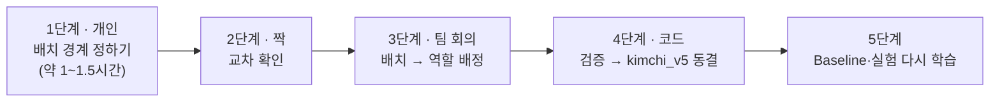

# 수동 분할 가이드 (`kimchi_v5`) — 6명이 "같은 장면 묶음"을 직접 정하고 4개 역할로 나누기

> 대상: 교과 8 팀 6명 · 데이터: 교과 7 FINAL 900장 (라벨은 `kimchi_v4` 그대로)
> 결과: `kimchi_v5` Split (Train / Validation / Frozen Test / Bridge Holdout) · 기준서: [split_policy.md](split_policy.md)

## 0. 왜 다시 나누나

`kimchi_v4` 는 "촬영 간격 5분" 묶음을 기본으로 하고, 문제가 생긴 묶음 3개(G00·G12·G09)만 예외로 잘랐다. 그 결과 규칙이 일관되지 않고, Validation 132장 중 83장이 Train 과 같은 촬영 회차에서 나왔다. 이번에는 **사람이 사진을 보고 "같은 장면 세팅" 단위(배치)를 처음부터 끝까지 같은 규칙으로 정하고**, 그 배치를 통째로 역할에 배정한다.



## 1. 지켜야 할 원칙 (모든 단계)

| # | 원칙 | 이유 |
|---|---|---|
| 1 | **배치는 사진만 보고 정한다.** 모델 점수·예측 결과·실패 분석 사진·기존 Split(train/val/test)은 보지 않는다 | 결과를 보고 나누면 시험지를 모델에 맞추는 셈이 된다 |
| 2 | **배치는 쪼개지 않는다.** 한 배치는 하나의 역할로만 간다 | 같은 세팅의 사진이 Train·평가에 섞이면 점수가 부풀려진다 (누수) |
| 3 | 배치는 **촬영 순서상 연속**이어야 한다 (중간에 다른 배치가 끼면 안 됨) | 사진판 순서 그대로 경계만 긋는다 |
| 4 | 라벨은 고치지 않는다 (`kimchi_v4` 라벨 그대로) | 분할과 라벨을 동시에 바꾸면 무엇 때문에 결과가 바뀌었는지 설명할 수 없다 |
| 5 | Frozen Test 사진으로 모델을 평가한 적이 아직 없다 — 이번이 분할을 바꿀 수 있는 마지막 기회다 | 8일차 이후에는 바꾸지 않는다 |
| 6 | 사진은 PC 밖으로 보내지 않는다 (사진판 JPG 포함). 작업 시트 CSV 만 Git 으로 주고받는다 | NDA |

## 2. 준비 (팀에서 1명)

```bash
cd ~/group_3/subject8
python scripts/make_split_worksheet.py
```

| 생기는 것 | 위치 | Git |
|---|---|---|
| 담당자별 작업 시트 6개 | `manifests/manual_split/worksheet_A.csv` ~ `F.csv` | ✅ 올림 (사진 없음) |
| 촬영 순서 사진판 18장 (썸네일 + 정답 박스, 2분 이상 끊긴 곳은 **빨간 띠**) | `demo/manual_split/<담당>_<묶음>.jpg` | ❌ 각자 PC 에서 같은 명령으로 만든다 |

작업 시트는 이미 있으면 덮어쓰지 않는다 (작성 중인 내용 보호).

### 담당 배정 (촬영 묶음 경계를 따라 약 150장씩)

| 담당 | 촬영 묶음 | 날짜·시간 | 사진 | 교차 확인 |
|---|---|---|---:|---|
| A | G00 ~ G04 | 04-10 14:44 ~ 18:29 | 150 | B |
| B | G05 · G06 | 04-11 09:21 ~ 11:45 | 124 | A |
| C | G07 · G08 · G09 | 04-11 13:30 ~ 16:32 | 126 | D |
| D | G10 · G11 · G12 | 04-24 10:58 ~ 14:01 | 150 | C |
| E | G13 · G14 · G15 | 04-24 14:07 ~ 16:05 | 150 | F |
| F | G16 · G17 | 04-24 16:40 ~ 17:06 · 05-13 (이물 단독) | 200 | E |

F 는 사진이 많지만 G17(150장)은 배경이 같은 이물 단독 사진이라 빨리 끝난다. 이름은 팀에서 A~F 에 정해 아래 "담당자" 표에 적는다.

| A | B | C | D | E | F |
|---|---|---|---|---|---|
| | | | | | |

## 3. 1단계 — 배치 경계 정하기 (개인)

### 3.1 배치란

**같은 이물 세트를 놓고 위치만 바꿔 가며 연속으로 찍은 사진 묶음.** 촬영자가 "이물 세트를 바꾸거나 장면을 새로 꾸민 순간"이 경계다.

### 3.2 새 배치로 끊는 기준 — 하나라도 해당하면 끊는다

| # | 신호 | 사진판에서 보이는 모습 |
|---|---|---|
| ① | **이물 종류(Class 구성)가 바뀜** | `classes` 칸이 `6:5` → `1:5` 처럼 바뀜, 박스 색이 바뀜 |
| ② | **같은 Class 인데 실물이 바뀜** | 초록 파 → 빨간 고추, 꽃잎 → 마른 잎, 파란 조각 세트 → 흰 조각 세트 |
| ③ | **사진당 이물 개수 패턴이 바뀜** | 1개씩 → 5개씩 (`n_boxes`) |
| ④ | **배경·김치 양·조명·카메라 위치가 눈에 띄게 바뀜** | 김치 깔린 모양·밝기가 확 달라짐 |
| ⑤ | **촬영이 2분 이상 끊기고(빨간 띠) 다음 사진이 위 ①~④ 중 하나라도 다름** | 빨간 띠는 "확인해 볼 곳"일 뿐, 빨간 띠만으로 끊지는 않는다 |

### 3.3 끊지 않는 것

- 같은 이물 세트를 **위치·방향만 바꿔** 다시 놓은 사진 — 이게 바로 누수 위험이 큰 "같은 배치"다.
- 이물 1~2개가 빠지거나 추가된 정도 (세트가 그대로면 같은 배치).
- 김치를 살짝 다시 흩뜨린 정도.

### 3.4 크기 감각

- 보통 한 배치는 **10~50장**. 75장을 넘으면 정말 한 세팅인지 다시 본다.
- 5장보다 작으면 앞뒤 배치와 정말 다른지 다시 본다. 확실히 다르면 작아도 된다 (예: G01 은 1장).

### 3.5 작업 시트 채우기 (`worksheet_<담당>.csv`)

| 칸 | 쓰는 법 | 예 |
|---|---|---|
| `batch_id` | **모든 줄**에 쓴다. `<촬영묶음>-<알파벳>`, 촬영 순서대로 a, b, c… | `G00-a` (#1~#25), `G00-b` (#26~#50) |
| `same_object_as` | 다른 배치에서 **같은 실물 이물**을 봤으면 그 배치 ID (여러 개면 `;`) | `G05-a;G13-b` |
| `note` | 배치 **첫 줄에만** 끊은 이유 (3.2 의 번호) | `② 파→고추` |
| `review_ok`, `review_note` | 비워 둔다 (2단계 교차 확인자가 씀) | |

- 사진판으로 경계를 찾고, 애매하면 `image` 이름으로 원본을 열어 확대해서 본다 (교과 7 라벨링 프로그램이나 이미지 뷰어).
- 판단이 안 서면 `note` 에 `REVIEW: 이유` 를 적고 경계를 일단 긋는다 → 2단계·회의에서 결정.
- 엑셀로 열 때는 **UTF-8** 그대로 저장한다 (CSV UTF-8). 칸 순서·이름은 바꾸지 않는다.

## 4. 2단계 — 교차 확인 (짝)

짝(A↔B, C↔D, E↔F)의 시트와 사진판을 보고 **경계마다** 확인한다.

| 칸 | 쓰는 법 |
|---|---|
| `review_ok` | 배치 첫 줄에 `O` (동의) 또는 `X` (다르게 봄) |
| `review_note` | `X` 이면 어디서 끊어야 하는지 · 이유 (예: `#18 에서 한 번 더 끊어야 함 ③`) |

- `X` 는 둘이 이야기해서 정하고, 그래도 안 정해지면 3단계 회의 안건으로 올린다.
- 다 끝나면 각자 시트를 `feature/<이름>` 브랜치로 커밋해 모은다 (CSV 만, 사진 X).

## 5. 3단계 — 배치 → 역할 배정 (팀 회의, 약 1시간)

회의 전에 시트를 모아 **배치별 표**(배치 ID · 사진 수 · Class 별 박스 수 · 이물 하위 유형 · `same_object_as`)를 만들어 화면에 띄운다. 이 표만 보고 정한다 (원칙 1 — 모델 점수는 보지 않는다).

### 5.1 배정 규칙

| # | 규칙 |
|---|---|
| R1 | 단위는 **배치**. 한 배치는 한 역할 |
| R2 | `same_object_as` 로 이어진 배치는 **가능하면 같은 역할** (같은 실물이 Train 과 Test 에 같이 있으면 누수) |
| R3 | **Frozen Test·Bridge Holdout 은 Train 과 다른 촬영 회차(날짜·시간대)** 위주로 고른다. Validation 은 같은 회차가 섞여도 되지만 그 비율을 기록한다 |
| R4 | Val·Test·Bridge 각각에 **Class 0·1·2·3·5·6 이 모두** 들어간다. Class 별 박스 **15개 이상** (안 되면 회의에서 예외로 적는다) |
| R5 | **Train 에는 각 Class 의 하위 유형이 모두** 들어간다 — 파·고추 / 꽃잎·종이·마른 잎 / 넓게 썩은 갈변·반점 갈변 등 (`kimchi_v1` 실패 원인 H1·H2) |
| R6 | 이물 단독 사진(G17)은 **Train** (평가 장면은 김치+이물로 맞춘다 — 기존 결정 유지) |
| R7 | 사진 수 목표 (±10%): Train 약 600 · Validation 약 75~100 · Frozen Test 약 75~100 · Bridge 약 150. 숫자보다 R1~R6 이 먼저다 |
| R8 | Class 4(고무장갑)는 0건 — 신경 쓰지 않는다 |

### 5.2 회의 진행

1. 배정이 쉬운 것부터: G17 → Train (R6).
2. Test·Bridge 후보를 **다른 회차의 배치 묶음**으로 먼저 고른다 (R3).
3. 남은 배치 중 Val 을 고르고 나머지는 Train.
4. R4·R5 표를 확인하며 맞바꾼다.
5. 결정 사항과 **이유**를 회의록(`docs/project/` 의 회의 기록)에 남긴다 — 특히 규칙 예외.

## 6. 4단계 — 검증 · 동결 (코드)

배정 결과(`batch_id → split` 표)를 받아 코드가 확인하고 `kimchi_v5` manifest 를 만든다. 확인 항목:

- [ ] 900장 모두 `batch_id` 가 있고, 배치가 촬영 순서상 연속이다
- [ ] 한 배치가 두 역할로 나뉘지 않았다
- [ ] Val·Test·Bridge 에 Class 0·1·2·3·5·6 이 각각 15개 이상
- [ ] Train 과 같은 촬영 회차가 Test·Bridge 에 몇 장 섞였는지 (숫자로 기록)
- [ ] `same_object_as` 로 이어진 배치가 다른 역할로 간 경우 목록 (숫자로 기록)
- [ ] 역할별 사진 수 합계 900

통과하면 `split_policy.md` 에 `kimchi_v5` 를 추가하고 `Split 상태: FROZEN` 으로 둔다. `kimchi_v1`~`v4` 는 이력으로 남는다.

## 7. 5단계 — 다시 학습

Dataset Version 이 바뀌면 비교 기준도 같은 Version 이어야 한다 (가이드 11.5).

| 할 일 | 시간 (RTX 3060) |
|---|---|
| Baseline 재학습 (YOLO11n · 640 · 50 epoch) | 약 5분 |
| 실패 분석 (`09`) → 개선 변수 1개 결정 | 약 30분 |
| 개선 실험 재학습 (예: 1280 약 10분, 1920 약 22분) | 실험당 10~45분 |

`kimchi_v4` 의 Baseline·exp001~003 결과는 이력으로 남긴다 (Val 이 달라 `kimchi_v5` 와 직접 비교하지 않는다).

## 8. 일정 예시

| 언제 | 누가 | 무엇 |
|---|---|---|
| D 오전 | 1명 | 2. 준비 (시트·사진판 생성, 담당 배정) |
| D 오전~오후 | 6명 | 3. 배치 경계 (1인 약 1~1.5시간) |
| D 오후 | 짝 | 4. 교차 확인 (약 30분) |
| D 마지막 | 6명 | 5. 역할 배정 회의 (약 1시간) |
| D+1 오전 | 1명 | 6. 검증·동결 → 7. Baseline 재학습 |
