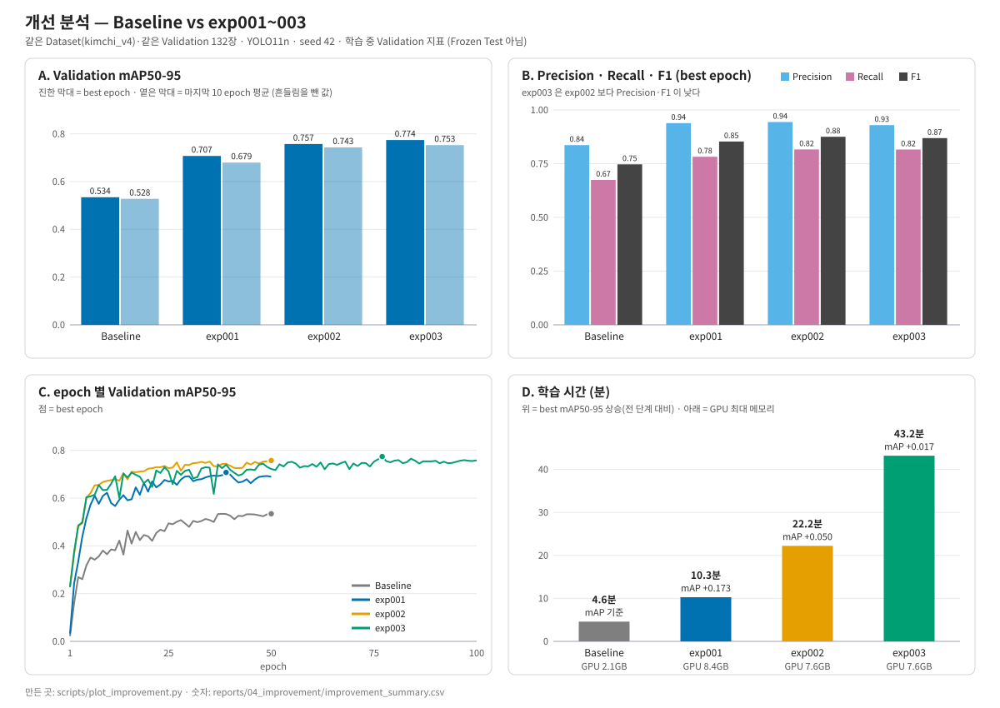

# Baseline vs Improved — 개선 분석 (`baseline_v4` · `exp001` · `exp002` · `exp003`)

> 산출물 5 · 7일차 (가이드 20.6). 같은 Dataset(`kimchi_v4`)·같은 Validation 132장·YOLO11n·seed 42.
> 숫자 근거: [`improvement_summary.csv`](improvement_summary.csv) (재현: `python scripts/plot_improvement.py`) · 원자료 `runs/*/results.csv`.
> Class별·갈변 TP/FN/FP 숫자는 [README 10장](../../README.md)에 정리된 값을 옮겼다 (집계에 쓴 원자료 CSV 는 Git 에 없다).
> 모든 값은 **Validation** 기준이다. Frozen Test 는 아직 보지 않았다.

> **숫자 출처 두 가지**: 이 문서의 2~4장은 학습 중 Validation 지표(`results.csv`, best epoch)로 네 실행을 같은 방식으로 비교한다. README 10장의 표는 Weight 로 따로 평가한 공식 값이라 조금 다르다 (예: exp001 mAP50-95 0.7075 ↔ 0.712, Baseline 0.5344 ↔ 0.538). 차이는 0.005 이하이고 결론은 같다.



## 1. 한 줄 결론

**효과의 대부분은 입력 해상도(`imgsz`)에서 나왔고, 그 뒤의 개선은 점점 작아지면서 비용은 커진다.** mAP50-95 는 0.534 → 0.708(exp001) → 0.758(exp002) → 0.774(exp003)로 올랐다. exp003 의 마지막 상승(+0.017)은 README 의 채택 기준(+0.02)에 못 미치고 epoch 사이 흔들림과 비슷한 크기라서, 확실한 개선으로 보기 어렵다. **갈변(Class 5)은 1280 이후 거의 오르지 않았다.**

## 2. 같은 Validation 에서 비교

| | Baseline | exp001 | exp002 | exp003 |
|---|---:|---:|---:|---:|
| 바꾼 것 | (기준) imgsz 640 | imgsz → 1280 | imgsz → 1920 (batch 16 → 6) | epochs 50 → 100 |
| Precision | 0.8365 | 0.9386 | 0.9438 | 0.9293 |
| Recall | 0.6745 | 0.7820 | 0.8162 | 0.8158 |
| F1 (P·R) | 0.747 | 0.853 | 0.875 | 0.869 |
| mAP50 | 0.7636 | 0.8840 | 0.8910 | 0.9132 |
| **mAP50-95** (best epoch) | 0.5344 | 0.7075 | 0.7575 | 0.7742 |
| mAP50-95 (마지막 10 epoch 평균 ± 표준편차) | 0.528 ± 0.006 | 0.680 ± 0.011 | 0.743 ± 0.012 | 0.753 ± 0.005 |
| best epoch / 학습 epoch | 50 / 50 | 39 / 50 | 50 / 50 | 77 / 100 |
| 학습 시간 · GPU 최대 메모리 | 4.6분 · 2.1GB | 10.3분 · 8.4GB | 22.2분 · 7.6GB | 43.2분 · 7.6GB |

### 단계별 변화 (직전 단계 대비)

| 단계 | ΔP | ΔR | ΔmAP50 | ΔmAP50-95 (best) | ΔmAP50-95 (마지막10 평균) | 추가 시간 |
|---|---:|---:|---:|---:|---:|---:|
| Baseline → exp001 | **+0.102** | **+0.108** | **+0.120** | **+0.173** | +0.152 | +5.7분 |
| exp001 → exp002 | +0.005 | **+0.034** | +0.007 | +0.050 | +0.063 | +12.0분 |
| exp002 → exp003 | **−0.015** | −0.000 | +0.022 | +0.017 | +0.010 | +21.0분 |

## 3. Class 별로 보면 (공식 평가, mAP50-95 — README 10장)

| Class | Baseline | exp001 | exp002 | exp001 상승 | exp002 상승 (vs exp001) |
|---|---:|---:|---:|---:|---:|
| 0 leaf_paper | 0.550 | 0.728 | 0.755 | +0.177 | +0.027 |
| 1 plastic_stone_metal | 0.519 | 0.749 | 0.808 | **+0.230** | +0.060 |
| 2 branch | 0.521 | 0.681 | 0.721 | +0.160 | +0.039 |
| 3 insect | 0.465 | 0.691 | 0.764 | **+0.226** | +0.073 |
| 5 disease_browning | 0.536 | 0.651 | 0.653 | +0.116 | **+0.002** |
| 6 green_onion_pepper | 0.640 | 0.773 | 0.838 | +0.133 | +0.065 |

- 플라스틱류와 벌레가 가장 크게 올랐다. 작은 객체가 많은 Class 라서 해상도 가설(H4)과 방향이 같다.
- **갈변은 가장 적게 올랐고, 1280 → 1920 에서는 +0.002 로 멈췄다.** 갈변 박스를 원본 20px 안팎으로 보면 1280 에서 약 5px, 1920 에서도 약 8px 라서, 해상도를 더 키워도 한계가 있어 보인다 (타일링 같은 다른 변수가 필요할 수 있음).
- 갈변 검출 건수 (Val 75개, conf 0.25 · IoU 0.5): Baseline TP 60 · FN 15 · FP 5 → exp001 TP 63 · FN 12 · **FP 13** → exp002 TP 64 · FN 11 · FP 13. **놓침은 15 → 11 로 줄었지만 헛검출이 5 → 13 으로 늘었다.**

## 4. 좋아진 것 · 나빠졌거나 조심할 것

### 좋아진 것

- **exp001(imgsz 640 → 1280)** 이 가장 크다. Precision·Recall·mAP 가 모두 크게 올랐고(Recall +0.108), 비용은 학습 5.7분 추가였다.
- **exp002(→ 1920)** 는 Recall 을 한 번 더 올렸다(0.782 → 0.816). Precision 은 거의 그대로(+0.005)다.
- exp003 은 mAP50 이 가장 높다(0.913).

### 나빠졌거나 조심할 것

| 항목 | 내용 |
|---|---|
| **exp003 상승폭이 기준 미달** | README 10장 기준 +0.02 미만(+0.018, 공식 평가). 마지막 10 epoch 의 mAP50-95 표준편차는 0.005~0.012 라서 이 상승(+0.017 / 마지막10 평균 +0.010)은 흔들림과 비슷하다. seed 를 한 개만 썼으므로 우연일 수 있다 |
| **exp003 Precision·F1 하락** | exp002 → exp003 에서 Precision −0.015, F1 −0.006. mAP50 은 +0.022 올랐지만 Precision 이 내려갔다 |
| **과적합 신호 (exp003)** | Val cls loss 가 78 epoch 에서 최저(0.510)였다가 마지막 0.532 로 다시 올랐다. 마지막 epoch 의 Val/Train cls loss 비는 exp002 1.63 → exp003 2.04. 놓친 박스는 50 → 49 로 거의 그대로 (갈변 11 → 8, 나뭇잎 7 → 9) |
| **갈변 헛검출 증가** | 위 3장: FP 5 → 13 (exp001 이후 유지) |
| **best epoch 의 낙관** | best epoch 는 Validation 으로 고른 값이다. exp001 은 best 0.7075 인데 마지막 epoch 는 0.689 (−0.018). 같은 Validation 으로 고르고 보고하므로 실제보다 약간 높게 나온다 |
| **exp002 는 변수 2개** | imgsz 와 함께 batch 가 16 → 6 으로 바뀌었다 (GPU 메모리 때문). 갱신 1번당 사진 수는 64 → 66장으로 비슷하지만, 엄밀하게는 "해상도만의 효과"라고 단정할 수 없다 |
| **비용** | 학습 시간 4.6분 → 43.2분(약 9배), GPU 메모리 2.1GB → 7.6~8.4GB (RTX 3060 12GB 한계 근처) |

## 5. 6일차 실패 패턴 확인 현황

| 6일차 가설 | 확인한 것 | 아직 안 한 것 |
|---|---|---|
| H4 작은 이물을 놓친다 → 해상도로 줄어든다 | Class 별 mAP 상승(플라스틱·벌레 ↑), 갈변 FN 15 → 11, Recall 0.674 → 0.816 | **박스 크기별 Recall 재집계** (150px 미만 / 150~300px). 이 표가 있어야 "작은 박스에서 줄었다"를 직접 말할 수 있다 |
| H1·H2 Class 혼동(CLASS_ERROR) — 해상도로는 안 줄 것으로 예상 | — | 개선 Weight 로 CLASS_ERROR 건수 재집계 |
| H3 같은 물체에 두 Class (FP_DUPLICATE) — 추론 설정 문제 | — | `agnostic_nms=True` 비교 |

크기별 Recall 과 CLASS_ERROR 재집계는 사진이 필요하다 (이 PC 에는 없음). 사진이 있는 PC 에서:

```bash
cd subject8
python scripts/09_collect_failures.py --weights models/improved/exp001_best.pt --imgsz 1280 --prefix exp001_failure
python scripts/09_collect_failures.py --weights models/improved/exp002_best.pt --imgsz 1920 --prefix exp002_failure
```

`reports/03_failure_analysis/exp00N_failure_recall_by_size.csv` 를 Baseline 의 `failure_recall_by_size.csv` 와 비교하면 된다. 개선 모델의 Confusion Matrix 는 `07_evaluate_baseline.py` 가 인자 없이 Baseline 만 평가해서 따로 평가해야 한다.

## 6. Final Model 후보 (제안 — 팀 결정 필요)

Frozen Test 를 보기 전 Validation 근거로 후보를 좁힌다.

| 후보 | 근거 | 주의 |
|---|---|---|
| **exp002** (imgsz 1920 · 50 epoch) | exp001 보다 모든 지표가 높고, 상승폭(+0.05)이 기준(+0.02)과 흔들림보다 확실하다. exp003 보다 학습 시간이 절반 | batch 가 함께 바뀌었음 |
| exp003 (imgsz 1920 · 100 epoch) | Val mAP50·mAP50-95 최고 | 상승폭 +0.017~0.018 로 기준 미달, Precision 하락, 과적합 신호 |

- **제안: exp002 를 Final Model 후보로 하고 exp003 은 "기준 미달 — 보류"로 둔다.** exp001 은 exp002 가 모든 지표에서 넘으므로 후보에서 뺀다.
- 결정 전에 5장의 크기별 Recall 재집계를 해 두면 "해상도 개선이 작은 이물에서 났다"는 근거까지 정리된다.
- 시간이 되면 seed 를 바꿔 exp002·exp003 을 한 번씩 더 학습해, 차이가 재현되는지 본다.
- 확정되면 8일차에 Frozen Test 를 한 번만 쓴다.

## 7. 한계

- 모든 값은 같은 Validation 132장으로 고르고 보고한 것이라 최종 성능이 아니다 (Frozen Test 평가 전).
- seed 42 한 번뿐이라 실험 간 작은 차이는 우연일 수 있다.
- Val 은 촬영 묶음 G09·G12 에 치우쳐 있고 정상 김치 사진이 없다 ([`failure_hypothesis.md`](../03_failure_analysis/failure_hypothesis.md) H5, README "알려진 한계"). Scene Error(정상 김치 등)는 이 Val 로는 분석할 수 없다.
- 갈변처럼 매우 작은 대상은 1920 에서도 약 8px 라서, 이후 개선은 해상도 이외의 변수가 필요할 수 있다.
