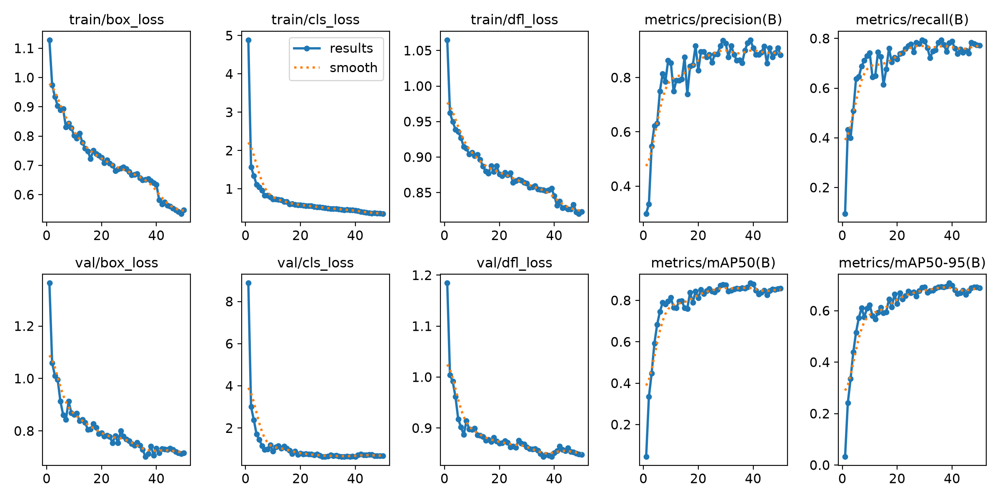
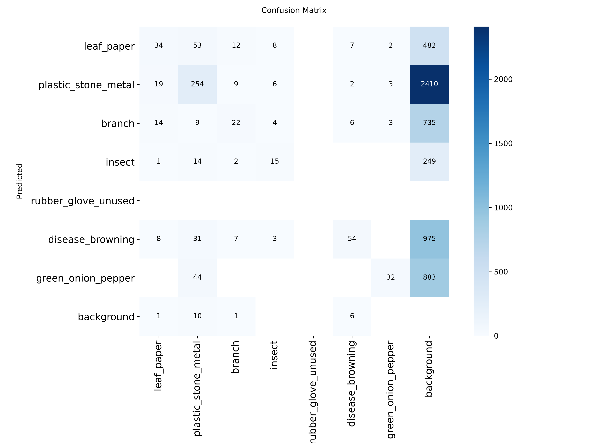
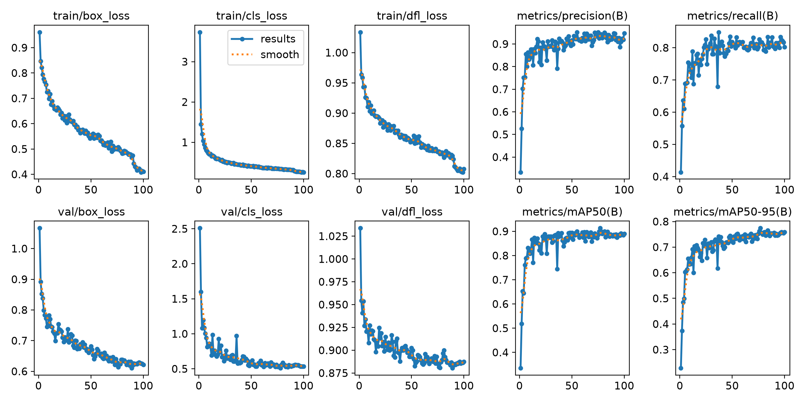
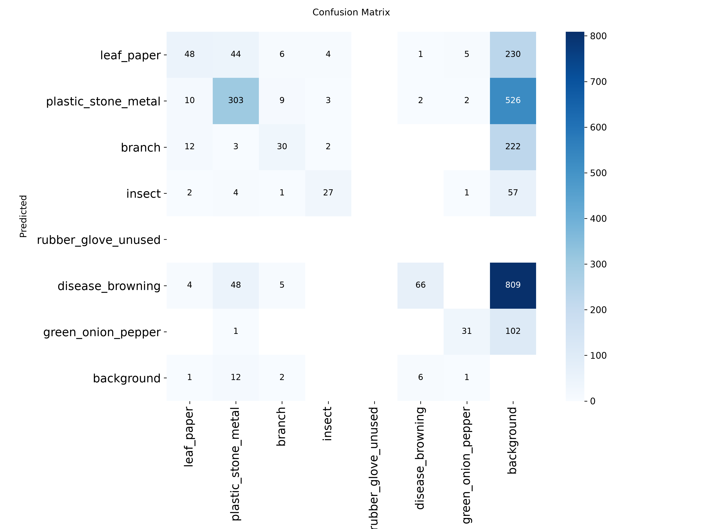

# Baseline vs Improved 비교 (`baseline_vs_improved.md`)

> 산출물 5 · 7일차 (가이드 20.6). 같은 Validation 에서 Baseline 과 개선 실험을 비교하고 Final Model 후보를 정한다.
> **Frozen Test 는 열지 않았다.** 모든 숫자는 Validation 기준이다.
> 가이드는 개선 실험을 `exp001` 하나로 예를 들었지만, 우리 팀은 3번(exp001 → exp002 → exp003) 했다. 가이드 경로의 `figures/exp001_*.png` 는 **첫 실험 exp001 자체의 결과**이고, Final Model 후보 exp003 의 그림은 `figures/exp003_*.png` 에 따로 둔다.

## 0. 이 비교까지 온 과정

### 0.1 출발점 — 첫 Baseline (`baseline_v1`, kimchi_v1, 640)

mAP50-95 **0.351**, 갈변 Recall 0.03, 나뭇가지 mAP50 0.17. 6일차 실패 분석(`failure_hypothesis.md`)에서 **위치는 찾지만 종류를 틀린다**는 결론과 함께 원인 후보 다섯 가지를 세웠다.

| 가설 | 내용 | 이후 대응 |
|---|---|---|
| H1 | Val 의 마른 잎·반점 갈변이 Train 에 없음 (Val 84장 중 75장이 G12 한 회차) | kimchi_v2 Split 재구성 |
| H2 | 파·고추 중 고추가 Train 에 3개뿐 | kimchi_v2 Split 재구성 |
| H3 | 같은 물체를 두 Class 로 예측 | `agnostic_nms` 비교 (예정) |
| H4 | 작은 이물을 놓침 — 원본 4848×2704 를 640 으로 줄이면 작은 이물이 16px 미만 | **해상도 실험 (이 문서의 exp001·exp002)** |
| H5 | 정상 김치를 이물로 봄 | 한계로 기록 (정상 김치 사진 없음) |

예비 실험 `pilot_v1_imgsz1280` (kimchi_v1, 640 → 1280): mAP50-95 0.351 → 0.519 로 **H4 확인**. 갈변은 0.003 → 0.041 로 거의 그대로여서 해상도만으로는 해결되지 않았다.

### 0.2 Dataset 수정 (v1 → v4)

| 버전 | 바꾼 것 | 이유 | Train / Val | 갈변 박스 Train / Val |
|---|---|---|---|---|
| v1 | 처음 분할 | — | 574 / 84 | 254 / 65 |
| v2 | G00 파/고추 구간별 분할, G12 가운데 배치 → Train, G05 → Val | H1 · H2, Val 이 한 회차에 몰림 | 551 / 107 | 266 / 53 |
| v3 | Class 5(갈변) 라벨 기준 개정·재라벨링, 머리카락 박스 1개 삭제 | 정답 기준이 애매함 (점 묶음·초록 잎맥·흐림) | 551 / 107 | 216 / 8 |
| v4 | G09 마지막 배치 25장 → Val | v3 Val 갈변이 8개뿐이라 평가 불가 | 526 / 132 | 149 / 75 |

- 원칙: 촬영 묶음 단위 분할 유지 + 통제된 예외 3건(G00 · G12 · G09). Test 와 Bridge 는 G00 일부 말고는 그대로.
- 재현: `python scripts/03_build_split.py --version kimchi_vN --copy-files` (기본값 v4).
- 가이드 11.5 · 20.5 ("같은 Dataset Version 에서 Baseline 과 Improved 를 비교")에 따라 **v4 에서 Baseline 을 다시 학습**했다 → 공식 Baseline `baseline_v4`.

### 0.3 같은 Val 에서 잰 비교만 모은 표

버전마다 Val 이 달라서 서로 다른 버전의 점수는 **직접 비교하지 않는다**. 같은 사진으로 잰 비교만 아래에 둔다.

| 비교 | 바꾼 것 | 같은 평가 사진 | 결과 |
|---|---|---|---|
| baseline_v1 → pilot_v1 | 해상도 640 → 1280 | v1 Val 84장 | mAP50-95 0.351 → 0.519 |
| pilot_v1 → history_v2 | Split (v1 → v2) | 두 버전 모두 Val 인 51장 | 전체 0.494 → 0.523, 나뭇잎 0.537 → 0.683 (Recall 0.49 → 0.77), 파·고추 mAP50 0.78 → 0.97 |
| history_v2 → history_v3 | 갈변 라벨 개정 | v3 Val 107장 | 갈변을 뺀 5개 Class 0.687 → 0.693 (그대로), 갈변 2/8 → 2/8 → **갈변 실패는 라벨 문제가 아니었다** |
| **baseline_v4 → exp001 → exp002 → exp003** | 해상도 · Epoch | **v4 Val 132장** | **아래 1~8장** |

> 주의: `baseline_v4` 의 갈변 mAP50 이 0.831 로 v3 시절(0.015)보다 크게 높은 것은 모델이 좋아져서가 아니라 **v4 에서 Val 갈변 구성이 바뀌었기 때문**이다.

## 1. 비교 조건

| 항목 | 값 |
|---|---|
| Dataset Version | `kimchi_v4` (`manifests/val.csv` 132장 · 정답 BBox 696개) |
| 비교 모델 | `baseline_v4` (`models/baseline/baseline_best.pt`) vs `exp001` · `exp002` · **`exp003`** (`models/improved/`) |
| 고정한 것 | YOLO11n · seed 42 · AdamW · lr0 0.001 · 증강 기본값 |
| 평가 방법 | `src/evaluate_detector.py` → `model.val(split="val")`, 각 모델은 **학습 때와 같은 imgsz** (`runs/<실행>/args.yaml`) |
| FP / FN 판정 | `scripts/09_collect_failures.py` — confidence 0.25, IoU 0.5 (6일차와 같은 기준) |
| 개선으로 인정하는 기준 | mAP50-95 **+0.02 이상** (그보다 작으면 노이즈 수준으로 본다 — 실험마다 학습을 한 번씩만 돌렸기 때문) |
| 평가 일시 | 2026-10-15, RTX 3060 12GB |

학습 중 기록(`reports/runs_summary.csv`)과 다시 평가한 값이 소수 넷째 자리까지 같아서, 같은 Validation 으로 평가했음을 확인했다.

## 2. 전체 성능

| 실행 | 바꾼 것 (비교 대상) | imgsz | Epoch | Precision | Recall | mAP50 | mAP50-95 | 놓침* |
|---|---|---:|---:|---:|---:|---:|---:|---:|
| `baseline_v4` | — | 640 | 50 | 0.8350 | 0.6752 | 0.7637 | 0.5381 | 172 (24.7%) |
| `exp001` | imgsz 640 → 1280 (Baseline 대비) | 1280 | 50 | 0.9359 | 0.7806 | 0.8849 | 0.7122 | 65 (9.3%) |
| `exp002` | imgsz 1280 → 1920 (exp001 대비) | 1920 | 50 | **0.9435** | **0.8161** | 0.8911 | 0.7563 | 50 (7.2%) |
| **`exp003`** | epoch 50 → 100 (exp002 대비) | 1920 | 100 | 0.9293 | 0.8154 | **0.9133** | **0.7740** | 49 (7.0%) |
| **Baseline → exp003** | | | | **+0.094** | **+0.140** | **+0.150** | **+0.236** | **−123** |

\* 놓침 = 정답 자리에 어떤 Class 박스도 없음 (confidence 0.25, IoU 0.5, 정답 696개)

| 단계 | mAP50-95 차이 | +0.02 기준 | 한 줄 해석 |
|---|---:|---|---|
| baseline_v4 → exp001 | **+0.174** | 통과 | 해상도만 올려 모든 Class 가 +0.12~0.23 |
| exp001 → exp002 | **+0.044** | 통과 | 주로 Recall 이 오름 (플라스틱 Recall 0.83 → 0.92) — 작은 이물을 더 찾음 |
| exp002 → exp003 | +0.018 | **미달** | 놓침 50 → 49. 77 epoch 점수가 튄 값일 가능성 (6장) |

각 실험은 바로 앞 실험에서 **변수 하나만** 바꿨다. 예외: exp002 는 1920 에서 batch 8 도 GPU 12.9GB 로 메모리를 넘어 **batch 16 → 6** 이 함께 바뀌었다. gradient 누적으로 업데이트 한 번에 쓰는 사진 수는 64 → 66장으로 거의 같게 맞췄다 (`exp002_training_condition.md`).

## 3. Class 별

### 3.1 mAP50-95 (네 모델)

| Class | 정답 | baseline_v4 (640) | exp001 (1280) | exp002 (1920) | exp003 (1920 · 100ep) | 1280 → 1920 |
|---|---:|---:|---:|---:|---:|---:|
| 0 leaf_paper | 77 | 0.550 | 0.728 | 0.755 | 0.790 | +0.027 |
| 1 plastic_stone_metal | 415 | 0.519 | 0.749 | 0.808 | 0.816 | +0.060 |
| 2 branch | 53 | 0.521 | 0.681 | 0.721 | 0.740 | +0.039 |
| 3 insect | 36 | 0.465 | 0.691 | 0.764 | 0.777 | +0.073 |
| 5 disease_browning | 75 | 0.536 | 0.651 | 0.653 | 0.679 | **+0.002** |
| 6 green_onion_pepper | 40 | 0.640 | 0.773 | 0.838 | 0.843 | +0.065 |

Class 4 (rubber_glove_unused) 는 Validation 에 정답이 0개라 평가하지 않는다.

### 3.2 baseline_v4 → exp003 상세

| Class | Precision | Recall | mAP50 | mAP50-95 |
|---|---|---|---|---|
| 0 leaf_paper | 0.674 → 0.848 | 0.592 → 0.818 | 0.664 → 0.871 | 0.551 → 0.790 |
| 1 plastic_stone_metal | 0.900 → 0.958 | 0.586 → 0.872 | 0.755 → 0.945 | 0.519 → 0.816 |
| 2 branch | 0.662 → 0.914 | 0.642 → 0.679 | 0.663 → 0.861 | 0.520 → 0.740 |
| 3 insect | 0.824 → 1.000 | 0.750 → 0.785 | 0.812 → 0.956 | 0.464 → 0.777 |
| 5 disease_browning | **0.982 → 0.857 ▼** | 0.739 → 0.877 | 0.831 → 0.882 | 0.536 → 0.679 |
| 6 green_onion_pepper | 0.968 → 1.000 | 0.744 → 0.861 | 0.857 → 0.966 | 0.640 → 0.843 |

## 4. 6일차에서 중요했던 FP / FN 패턴

### 4.1 실패 유형 (baseline_v4 → exp003)

| 실패 유형 | baseline_v4 | exp003 | 변화 |
|---|---:|---:|---|
| TP (정답 696개 중) | 475 (68.2%) | 615 (88.4%) | +140 |
| FN (놓침) | 172 | 49 | −123 |
| CLASS_ERROR (위치는 맞고 종류 틀림) | 49 | 32 | −17 |
| FP_DUPLICATE (같은 물체를 두 Class 로, H3) | 45 | 29 | −16 |
| FP_PARTIAL (박스 위치·크기 어긋남) | 48 | 10 | −38 |
| FP_BACKGROUND (김치·배경을 이물로, H5) | 35 | 12 | −23 |

### 4.2 작은 객체 (H4 — 개선 실험의 근거) · 박스 한 변 150px 미만 Recall

| Class | baseline_v4 | exp003 |
|---|---:|---:|
| plastic_stone_metal | 118/233 = 0.51 | **206/233 = 0.88** |
| disease_browning | 7/17 = 0.41 | 10/17 = 0.59 |
| branch | 6/16 = 0.38 | 9/16 = 0.56 |
| green_onion_pepper | 22/28 = 0.79 | 26/28 = 0.93 |
| leaf_paper | 0/9 = 0.00 | **0/9 = 0.00 (그대로)** |

놓친 것(FN)의 대부분이던 plastic_stone_metal 이 121개 → 20개로 줄었다. 해상도를 올린 것이 작은 이물에 직접 효과가 있었다는 H4 가설과 맞는다.

### 4.3 갈변 (Val 75개, confidence 0.25 · IoU 0.5)

| 해상도 | TP (맞힘) | FN (놓침) | FP (헛검출) |
|---|---:|---:|---:|
| 640 (baseline_v4) | 60 | 15 | 5 |
| 1280 (exp001) | 63 | 12 | **13** |
| 1920 (exp002) | 64 | 11 | 13 |
| 1920 · 100ep (exp003) | 67 | 8 | 20 (배경 7 · 중복 11 · 위치 어긋남 2)* |

\* exp003 은 `exp003_failure_summary.csv` 에서 센 값이다. 위 세 줄과 세는 방식이 다를 수 있어(위 세 줄은 7일차 작업 기록) 같은 표에서 바로 비교하기보다 "exp003 에서 갈변 헛검출이 줄지 않았다" 정도로 읽는다.

갈변은 1280 이후로 거의 그대로다. Val 갈변 대부분이 넓게 썩은 잎(G09)이라 1280 에서도 이미 충분히 크게 보이기 때문이다. 작은 갈색 줄무늬에 해상도가 효과가 있는지는 Val 에 그런 예가 거의 없어 확인하지 못했다.

## 5. 나빠진 것 · 그대로인 것

| 항목 | 이전 | 이후 | 내용 |
|---|---|---|---|
| 갈변 헛검출 (baseline_v4 → exp001) | 5 | **13** | 해상도를 올리자 갈변을 더 찾는 대신 헛검출이 늘었다 |
| disease_browning Precision (baseline_v4 → exp003) | 0.982 | **0.857** | Recall 0.739 → 0.877 과 맞바꿈. 다른 것을 갈변이라고 하는 경우가 생겼다 |
| 배경을 갈변으로 (FP_BACKGROUND, → exp003) | 0 | **7** | baseline 에 없던 새 오검출. 배경 오검출 12개 중 7개 |
| 플라스틱 → 갈변 (CLASS_ERROR, → exp003) | 상위에 없음 | **8** | exp003 의 가장 많은 종류 오류 |
| 같은 물체를 갈변으로 한 번 더 (FP_DUPLICATE, → exp003) | 1 | **11** | H3 (중복 박스) 이 갈변에서 커졌다 |
| 작은 leaf_paper (150px 미만) | 0/9 | 0/9 | 해상도를 올려도 못 찾음 — Train 에 작은 나뭇잎이 적은 데이터 문제로 보임 |
| Precision (exp002 → exp003) | 0.9435 | 0.9293 | Epoch 100 이 mAP 는 올렸지만 Precision 은 조금 낮다 |
| 파·고추 Confusion Matrix (exp001 → exp002) | 0.82 | **0.37** | 같은 모델의 mAP·Recall 은 올라서 숫자가 서로 맞지 않는다. 중복 박스 영향으로 추정 — `agnostic_nms` 로 확인 필요 |
| 학습·추론 비용 | | | 7장 |

Confusion Matrix 의 background 열 값이 큰 것은 `model.val()` 이 confidence 0.001 까지 세기 때문이다. 4장 표(confidence 0.25)가 실제 사용 기준에 가깝다.

## 6. exp003 과적합 확인 (Epoch 100)

| 확인 | 값 | 출처 |
|---|---|---|
| best epoch | **77** (mAP50-95 0.774) | `runs/exp003_v4_imgsz1920_epoch100/results.csv` |
| 71~80 epoch 평균 | 0.751 | 같은 파일 |
| 91~100 epoch 평균 | 0.753 | 같은 파일 |
| 100 epoch (마지막) | 0.759 | 같은 파일 |
| exp002 best (50 epoch) | 0.757 | `runs/exp002_v4_imgsz1920/results.csv` |
| Train – Val mAP50-95 차이 | 50ep 0.137 · 77ep 0.136 · 100ep 0.168 | 7일차 작업 기록 |
| Loss | Train loss 는 100 epoch 까지 계속 내려가고, Val loss 는 78~90 epoch 부터 평평 | `figures/exp003_loss_curves.png` |

- **77 epoch 점수(0.774)는 혼자 튄 값**이다. 후반 평균은 0.75 안팎으로 exp002 best(0.757)와 거의 같다.
- 78 epoch 이후 약한 과적합이 있다. best.pt(77 epoch)가 그 앞에서 저장돼 과적합을 피해 갔다 → **항상 best.pt 를 쓴다**.
- 처음부터 있던 차이 0.137 은 과적합이 아니라 **처음 보는 촬영 회차에 대한 일반화 차이**로 본다.
- 1920 에서 적정 학습량은 약 70~80 epoch.


## 7. 속도와 비용

| 실행 | 학습 시간 | batch | 추론 ms/장 (batch 1, FP32)* | FPS* | 추론 ms/장 (`model.val`) |
|---|---:|---:|---:|---:|---:|
| baseline_v4 (640) | 약 5분 | 16 | 8.5 | 117 | 5.5 |
| exp001 (1280) | 약 10분 | 16 | 12.0 | 83 | — |
| exp002 (1920) | 약 22분 | 6 | 21.0 | 48 | — |
| exp003 (1920 · 100ep) | 약 43분 | 6 | 21.0 (exp002 와 같은 구조) | 48 | 13.3 |

\* RTX 3060, JPG 디코딩(약 58.5ms/장) 제외. 두 측정은 방법이 달라 열끼리만 비교한다. 교과 14 Jetson 에서는 더 느리므로 따로 측정해야 한다.

## 8. Final Model 후보

**후보: `exp003` (`models/improved/exp003_best.pt`, imgsz 1920, epoch 100, best 77 epoch)**

| 근거 | |
|---|---|
| mAP50-95 · mAP50 가장 높음 | 0.7740 / 0.9133 (exp002 0.7563 / 0.8911) |
| FN · FP 모두 감소 | 놓침 172 → 49, 오검출 합계 128 → 51 (baseline_v4 대비) |
| 6일차 가설과 일치 | 작은 이물 Recall 이 가장 크게 올랐다 (H4) |
| 추론 비용은 exp002 와 같음 | 같은 구조·같은 imgsz 라 실제 사용 속도는 차이가 없다. 더 든 것은 학습 시간뿐 |

**exp002 와의 차이를 정직하게 기록한다**

| 관점 | exp002 | exp003 |
|---|---|---|
| mAP50-95 | 0.757 | 0.774 (+0.018, **미리 정한 +0.02 기준 미달**) |
| Precision | **0.944** | 0.929 |
| 놓침 | 50 | 49 |
| 학습 시간 | **22분** | 43분 |
| 후반 epoch 평균 mAP50-95 | 0.743 (41~50) | 0.751~0.753 (71~100) |

7일차 작업 기록에서는 "+0.02 기준을 지키면 exp003 은 노이즈 수준이고 학습 시간이 절반"이라는 이유로 **exp002 를 후보로 적었다**. 팀은 최고 점수와 낮은 놓침을 근거로 exp003 을 후보로 정했다. 두 모델은 추론 속도가 같으므로, 8일차 Prediction 이미지에서 갈변 오검출과 Precision 차이를 직접 보고 최종 확정한다.

**확정 전에 볼 것**
- 갈변 오검출(배경 7 · 중복 11 · 플라스틱→갈변 8)이 실제 사용에서 문제가 되는지 — 8일차 Prediction 이미지에서 확인
- 추론 속도가 교과 14 요구에 맞는지. 맞지 않으면 exp001(1280, mAP50-95 0.712, 83 FPS)이 대안
- Frozen Test 는 Final Model 을 `models/final/final_best.pt` 로 확정한 뒤 8일차에 **한 번만** 평가한다

## 9. 남은 한계와 다음 할 일

**남은 한계**
- 작은 갈변 — 해상도와 데이터 모두 부족 (원본 짧은 변 20px 안팎은 1280 에서 3~5px)
- Val 갈변 대부분이 G09 한 회차 출신이라 갈변 점수가 낙관적일 수 있다
- 머리카락 등 Class 0~6 에 없는 이물은 검출 대상이 아니다
- 정상 김치(Negative) 사진이 없다 (H5)
- 실험마다 학습을 한 번씩만 돌렸다 (seed 42). 작은 차이는 노이즈일 수 있다

**다음 할 일**
1. `agnostic_nms` 비교 — 재학습 없이 H3(중복 박스)와 파·고추 Confusion Matrix 불일치 확인
2. 위아래 뒤집기 + 회전 증강 실험 — 위에서 찍은 사진이라 방향이 의미 없음, Train–Val 차이 0.137 대응
3. yolo11s 비교 (1280) — 종류 혼동 대응
4. 7일차 나머지 산출물: `improvement_experiment.md`, `experiment_log.csv`
5. Final Model 확정 → Frozen Test 1회 평가

## 10. 그래프

### 10.1 exp001 (가이드 20.6 경로 · imgsz 1280)

**학습 곡선** — `figures/exp001_results.png`



**Validation Confusion Matrix** — `figures/exp001_confusion_matrix.png`



### 10.2 exp003 (Final Model 후보 · imgsz 1920 · epoch 100)

**학습 곡선** — `figures/exp003_results.png`



**Validation Confusion Matrix** — `figures/exp003_confusion_matrix.png`



### 10.3 baseline_v4 (비교 기준 · imgsz 640)

**학습 곡선** — `figures/baseline_results.png`


**Validation Confusion Matrix** — `figures/baseline_confusion_matrix.png`


### 10.4 kimchi_v4 실행 비교 (같은 Val 132장)

**Val mAP50-95 epoch 별 · best 값** — `figures/runs_comparison_kimchi_v4.png`


## 11. 근거 파일

| 파일 | 내용 |
|---|---|
| `figures/exp001_results.png` | exp001 학습 곡선 (가이드 20.6 경로, `runs/exp001_v4_imgsz1280/results.csv` 로 그림) |
| `figures/exp001_confusion_matrix.png` · `_normalized.png` | exp001 Validation Confusion Matrix (가이드 20.6 경로, imgsz 1280) |
| `figures/exp003_results.png` | exp003 학습 곡선 (`runs/exp003_v4_imgsz1920_epoch100/results.csv` 로 그림) |
| `figures/exp003_confusion_matrix.png` · `_normalized.png` | exp003 Validation Confusion Matrix |
| `figures/exp003_loss_curves.png` | exp003 Train/Val Loss — 과적합 확인 (6장) |
| `figures/baseline_results.png` · `baseline_confusion_matrix.png` | baseline_v4 (5일차) |
| `baseline_v4_failure_*.csv` · `exp003_failure_*.csv` | 실패 1건 = 1줄, 유형×Class, 크기별 Recall |
| `runs_summary.csv` · `figures/runs_comparison_kimchi_v4.png` | 실행별 학습 기록 |
| `exp001_training_condition.md` · `exp002_*` · `exp003_*` | 실험별 학습 조건 |
| `failure_hypothesis.md` | 6일차 가설 H1~H5 |
| `demo/failure_analysis/baseline_v4_failure/` · `exp003_failure/` | 대표 실패 사진 (회사 사진 → Git 제외) |

**재현**

```bash
python scripts/03_build_split.py --copy-files          # data/yolo 를 kimchi_v4 로 (manifest 는 바뀌지 않음)
python scripts/09_collect_failures.py --weights models/baseline/baseline_best.pt --imgsz 640 --prefix baseline_v4_failure
python scripts/09_collect_failures.py --weights models/improved/exp003_best.pt --imgsz 1920 --prefix exp003_failure
python scripts/plot_runs.py                             # 학습 곡선 · runs_summary.csv
```

전체 지표는 `src/evaluate_detector.evaluate_detector(weight, "configs/dataset.yaml", split="val", imgsz=<학습 imgsz>, batch=<학습 batch>)` 로 다시 얻을 수 있다.
