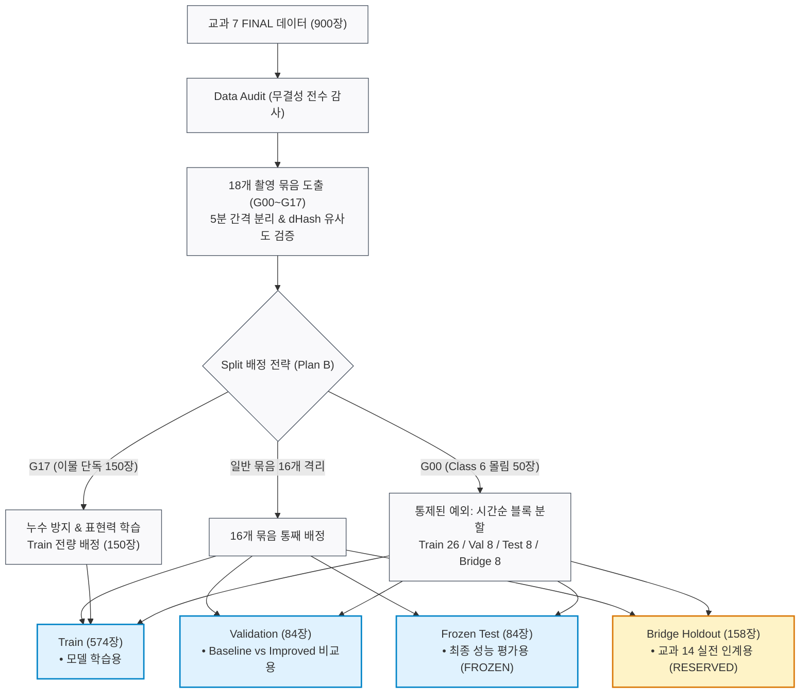

# Subject 8 — Dataset Split 정책서 (`split_policy.md`)

> **문서 ID**: S08-DOC-001  
> **Dataset Version**: `kimchi_v1`  
> **Split 상태**: `FROZEN`  
> **Bridge Holdout 상태**: `RESERVED FOR SUBJECT 14`  
> **대상 데이터**: 교과 7 FINAL 데이터셋 (4K JPG 900장 + YOLO TXT 900개)  
> **확정 일자**: 2026-10-12 (2일차 확정 / 3일차 동결)  
> **핵심 원칙**: 촬영 묶음(`capture_group`) 단위 분할을 통한 회차 누수(Data Leakage) 차단 및 희귀 Class 6 평가를 위한 제어된 예외 적용  

---

## 1. 📌 Split 정책 개요 및 원칙

본 문서는 교과 7에서 전수 검수를 마친 900장의 데이터를 교과 8 개발용(`Train`, `Validation`, `Frozen Test`)과 교과 14 연결용(`Bridge Holdout`)의 4가지 역할로 나누는 분할 기준을 정의합니다.

### 1.1 핵심 분할 원칙
1. **회차(Session) 누수 방지**:
   - 같은 김치, 같은 조명, 같은 시간대에 연속 촬영된 유사 사진들이 서로 다른 Split에 섞여 들어가는 **Data Leakage를 방지**하기 위해, 개별 사진 단위가 아닌 **촬영 묶음(`capture_group`) 단위로 통째로 배정**합니다.
2. **희귀 클래스 평가 가능성 보장 (통제된 예외 1건)**:
   - Class 6(파·고추)는 전체 900장 중 G00(50장) 묶음에 사실상 전량 몰려 있습니다. 완전 묶음 단위 분할 시 Val/Test/Bridge에서 Class 6 평가가 불가능해지므로, **G00 묶음 50장에 한해 시간순 연속 블록 분할 예외를 적용**합니다.
3. **교과 14 실전 검사 환경 정합성 (이물 단독 150장 처리)**:
   - G17(이물 단독 150장)은 동일한 배경에서 연속 촬영되어 사진 간 유사도가 매우 높으므로, 여러 Split으로 쪼갤 경우 누수 위험이 큽니다.
   - 또한 교과 14는 컨베이어 벨트 위의 '김치+이물'을 검사하는 실전 프로젝트이므로, **G17(150장)은 모델의 순수 객체 표현력 학습을 위해 Train에 전량 배정**하고, Val / Test / Bridge는 100% '김치+이물' 실전 장면으로만 구성합니다.

### 1.2 원본 데이터 출처 구성 (교과 7 FINAL)
* **이물검출_학습데이터1 (train)**: 500장
* **이물검출_학습데이터2 (train)**: 220장
* **이물검출_학습데이터2 (validation)**: 180장
* **총합**: 900장 (JPG 900장 + TXT 900개 전수 무결)

### 1.3 데이터 분할 아키텍처


---

## 2. 🔍 촬영 묶음(`capture_group`) 정의 및 유사도 검증

### 2.1 묶음 분리 기준
* **분리 규칙**: 파일명 타임스탬프(`YYMMDD_HHMMSS`) 기준 **촬영 간격이 5분(300초)을 초과하는 지점**에서 분리
* **결과**: 총 **18개 묶음 (`G00` ~ `G17`)** 생성

### 2.2 이미지 유사도 (dHash) 검증 결과
* 900장 전체를 차이 해시(dHash) 알고리즘으로 전수 비교한 결과:
  - 거의 동일한 사진 쌍은 **100% 동일한 묶음 내부에서만 발견**되었습니다.
  - **서로 다른 묶음 간의 유사 사진 쌍은 0쌍(Zero Leakage)**으로 확인되었습니다.
* Class 6 묶음(`G00`) 내부 사진끼리의 차이는 중앙값 104로, 서로 다른 묶음 간의 평균 차이(112)와 유사하여 **G00 50장의 배치와 형태가 모두 상이함(육안 및 수치 검증 완료)**을 확인했습니다.

---

## 3. 🗺️ 18개 촬영 묶음 구성표

| 묶음 ID | 장수 | 촬영 일자 및 시간 | 주요 Class | 장면 유형 (Scene Type) | 배정 역할 |
|:---:|:---:|---|---|---|:---:|
| **G00** | 50 | 250410 14:44 ~ 15:28 | **Class 6 (파·고추)** 50장 몰림 | 김치+대상 객체 | **분할 예외 (Train 26 / Val 8 / Test 8 / Bridge 8)** |
| **G01** | 1 | 250410 15:50 | Class 1 | 김치+대상 객체 | **Validation** |
| **G02** | 10 | 250410 15:55 ~ 16:01 | Class 1 | 김치+대상 객체 | **Train** |
| **G03** | 39 | 250410 16:56 ~ 17:36 | Class 1, 2, 0 | 김치+대상 객체 | **Train** |
| **G04** | 50 | 250410 17:42 ~ 18:29 | Class 2 (나뭇가지 50) | 김치+대상 객체 | **Train** |
| **G05** | 48 | 250411 09:21 ~ 10:08 | Class 1 | 김치+대상 객체 | **Train** |
| **G06** | 76 | 250411 10:43 ~ 11:45 | Class 1 (판단어려움 1 포함) | 김치+대상 객체 | **Train** |
| **G07** | 26 | 250411 13:30 ~ 13:54 | Class 1, 2, 3 | 김치+대상 객체 | **Frozen Test** |
| **G08** | 25 | 250411 14:00 ~ 14:23 | Class 1 | 김치+대상 객체 | **Train** |
| **G09** | 75 | 250411 15:17 ~ 16:32 | **Class 5 (갈변 62)** | 김치+대상 객체 | **Train** |
| **G10** | 50 | 250424 10:58 ~ 11:30 | Class 2 (나뭇가지 50) | 김치+대상 객체 | **Bridge Holdout** |
| **G11** | 25 | 250424 11:43 ~ 11:54 | Class 1, 5 | 김치+대상 객체 | **Train** |
| **G12** | 75 | 250424 13:12 ~ 14:01 | Class 0, 1, 5 | 김치+대상 객체 | **Validation** |
| **G13** | 50 | 250424 14:07 ~ 14:35 | Class 0 (나뭇잎 50), 5 | 김치+대상 객체 | **Bridge Holdout** |
| **G14** | 50 | 250424 15:03 ~ 15:36 | Class 2 (나뭇가지 50) | 김치+대상 객체 | **Frozen Test** |
| **G15** | 50 | 250424 15:43 ~ 16:05 | **Class 3 (벌레 50)** | 김치+대상 객체 | **Bridge Holdout** |
| **G16** | 50 | 250424 16:40 ~ 17:06 | Class 0 (나뭇잎 50) | 김치+대상 객체 | **Train** |
| **G17** | 150 | 250513 01:41 ~ 02:24 | C0, C1, C2, C3 | **대상 객체 단독 (150장 전량)** | **Train** |

---

## 4. 📊 최종 분할 결과 및 클래스별 분포표

G00 블록 분할 및 17개 묶음 배정 결과, **모든 역할에 Class 0~6(미사용 4 제외)이 고르게 확보**되었습니다.

| 역할 (Role) | 전체 수량 | C0 (나뭇잎) | C1 (플라스틱) | C2 (나뭇가지) | C3 (벌레) | C5 (갈변) | C6 (파·고추) | 배정된 묶음 |
|---|:---:|:---:|:---:|:---:|:---:|:---:|:---:|---|
| **Train** | **574장** | 143 | 421 | 206 | 97 | 86 | **29** | G02~G06, G08, G09, G11, G16, G17(단독), G00(일부) |
| **Validation** | **84장** | 61 | 52 | 24 | 19 | 44 | **8** | G01, G12, G00(일부) |
| **Frozen Test** | **84장** | 16 | 51 | 67 | 21 | 25 | **8** | G07, G14, G00(일부) |
| **Bridge Holdout** | **158장** | 65 | 72 | 75 | 60 | 43 | **9** | G10, G13, G15, G00(일부) |
| **전체 합계** | **900장** | 285 | **596** | 372 | 197 | 198 | **54** | **18개 묶음 전량 수용** |

*(주: 클래스별 숫자는 해당 클래스 BBox가 1개 이상 포함된 이미지 수임. C1 합계는 판단어려움 1장을 포함하여 596장임)*

---

## 5. 🎯 G00 시간순 블록 분할 예외 규정

Class 6이 집중된 `G00(50장)`은 띄엄띄엄 무작위 추출하지 않고, **촬영 시간순 연속 블록**으로 절단하여 인접 누수를 최소화합니다:

```text
G00 시간순 50장
├── 01 ~ 26번째 (26장) ──> Train 배정
├── 27 ~ 34번째 ( 8장) ──> Validation 배정
├── 35 ~ 42번째 ( 8장) ──> Frozen Test 배정
└── 43 ~ 50번째 ( 8장) ──> Bridge Holdout 배정
```

* **정당화 사유**:
  1. 원칙을 엄격 준수할 경우 Val/Test/Bridge에서 Class 6 평가 지표가 완전히 공백(Zero)이 되는 실무적 위험 방지
  2. G00 내 사진들은 조작자가 매번 다른 김치 조각과 이물질을 배치하여 촬영했음이 육안 확인됨
  3. 연속 블록으로 분할하여 경계선 3곳을 제외한 내부 이미지 간에는 누수 최소화

---

## 6. ⚠️ 알려진 한계 및 발표 Q&A 대응 전략

1. **Q. G00만 예외로 쪼갠 것은 원칙 위반 아닌가요?**
   - **답변**: "원칙은 묶음 단위 분할입니다. 단, 묶음을 완전히 고수할 때 특정 클래스를 아예 평가할 수 없는 치명적 결손이 발생하는 경우에만 엄격히 통제된 1건의 예외를 두었습니다. G00 내부 이미지들은 형태 다양성이 검증되었고 시간순 블록으로 분할하여 경계 누수를 최소화했습니다."
2. **Q. Val과 Test의 클래스 비율이 조금 다른 이유는 무엇인가요?**
   - **답변**: "묶음 단위(회차 단위)로 분할했기 때문에 회차별 이물 집중도에 따라 비율 차이가 발생합니다. 따라서 모델 비교 시 mAP 단일 점수뿐만 아니라 클래스별 mAP 및 Recall 지표를 반드시 교차 검증합니다."
